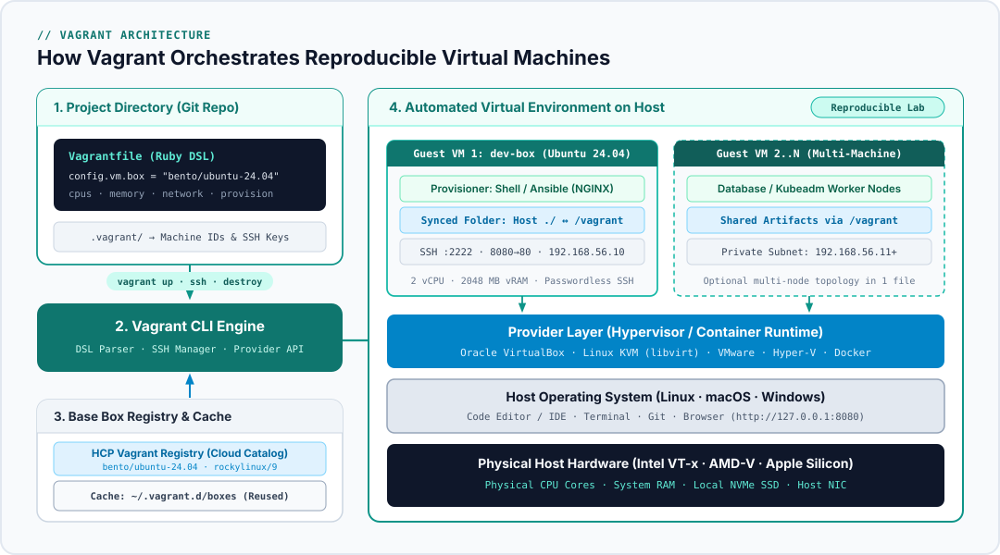
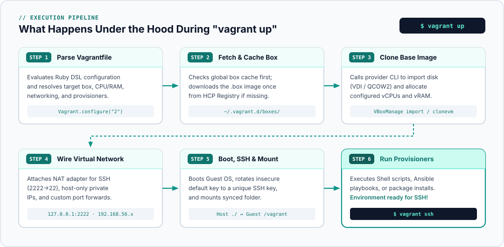

Spinning up a single virtual machine through a desktop GUI wizard takes ten minutes of downloading ISOs, clicking through disk partition menus, configuring NAT network adapters, and setting up SSH keys. Doing that manually across three nodes for a local `kubeadm` cluster—or asking five teammates to replicate the exact same Linux kernel, packages, and IP layout—quickly turns into hours of configuration drift and *"it works on my machine"* debugging.

**Vagrant** eliminates manual VM setup by bringing **Infrastructure as Code (IaC)** principles to local and lab virtualization. Instead of clicking through hypervisor menus, you describe your entire virtual machine topology—base OS image, CPU and memory limits, networking, shared directories, and bootstrap scripts—inside a single text file called a **`Vagrantfile`**, and bring the whole environment online with one command: `vagrant up`.

In **Part 1** of this Vagrant series, we break down what Vagrant is, how its provider-and-box architecture works under the hood, how to install Vagrant and VirtualBox across Linux, macOS, and Windows, and how to build, network, and provision your first reproducible Ubuntu VM from scratch.

> **Prerequisite Context:** If you want a refresher on how Host vs. Guest systems, hardware virtualization (`Intel VT-x` / `AMD-V`), and **Type 1 vs. Type 2 hypervisors** work beneath Vagrant, check out [Virtualization, Virtual Machines, and Hypervisors: A Practical Guide for Cloud & DevOps Engineers](https://blog.mahinraza.online/posts/2026-11-17-virtualization-virtualMachine-and-hypervisor/).

---

## What Is Vagrant?

**Vagrant** is a command-line automation tool written in **Ruby** that builds, configures, and manages portable, reproducible virtual machine environments through a single declarative workflow.

Rather than acting as a hypervisor itself, Vagrant sits **on top of** existing virtualization engines (such as **Oracle VirtualBox**, **Linux KVM / `libvirt`**, **VMware Workstation/Fusion**, **Microsoft Hyper-V**, or **Docker**) and exposes one consistent CLI and configuration syntax across all of them.

### Brief Origin Story

Vagrant was started in **January 2010** by **Mitchell Hashimoto** as a personal side project to stop wasting hours rebuilding disposable development environments for client consulting work. Version `0.1.0` shipped in **March 2010**, and rapid adoption across engineering teams led Hashimoto (with Armon Dadgar) to co-found **HashiCorp** in **2012** to support Vagrant full-time—laying the design foundation that later inspired **Packer**, **Terraform**, **Vault**, and **Consul**.

### Why DevOps & Platform Engineers Still Use Vagrant

Even in a container-first world, containers share your host OS kernel—meaning you cannot test custom kernel modules (`br_netfilter`, `overlay`, eBPF programs), `systemd` init units, `iptables`/`nftables` firewalls, disk filesystems, or multi-node cluster bootstrapping (`kubeadm`, Ansible roles, Patroni HA PostgreSQL) cleanly inside a single unprivileged container. Vagrant shines whenever you need **real, isolated OS kernels** on demand:

- **Declarative Reproducibility:** Commit a 25-line `Vagrantfile` to Git; every engineer on Linux, macOS, or Windows boots the exact same OS version, network topology, and package state.
- **One-Command Lifecycle:** Create and provision (`vagrant up`), connect (`vagrant ssh`), pause (`vagrant suspend`), or wipe every trace (`vagrant destroy -f`) in seconds.
- **Zero-Config Developer Ergonomics:** Vagrant automatically generates per-VM SSH keys, forwards ports, and mounts your host project directory inside the guest at `/vagrant` so you can edit files in your local IDE while running code inside Linux.
- **Disposable Sandboxes:** Break `/etc/fstab` or lock yourself out with `ufw`? Run `vagrant destroy -f && vagrant up` to get a clean slate in under a minute.

---

## Core Architecture & Terminology

Before running commands, it helps to understand the six building blocks that make up every Vagrant project.



| Component | Role in Vagrant | Real-World Example |
| :--- | :--- | :--- |
| **`Vagrantfile`** | Version-controlled Ruby DSL file placed at the root of your project that declares VM hardware, network, synced folders, and provisioning steps. | `config.vm.box = "bento/ubuntu-24.04"` |
| **Box** | Pre-packaged, versioned base OS image archive (`.box`) containing a virtual disk, box metadata, and pre-configured `vagrant` SSH user. | `bento/ubuntu-24.04`, `ubuntu/noble64`, `rockylinux/9` |
| **Provider** | Underlying hypervisor or container runtime that actually executes the guest machine; Vagrant translates `Vagrantfile` settings into provider API/CLI calls. | `virtualbox`, `libvirt` (KVM), `vmware_desktop`, `hyperv`, `docker` |
| **Provisioner** | Automation hook that installs packages, writes configs, and starts services automatically when the VM boots for the first time. | Shell scripts, `Ansible`, `Chef`, `Puppet`, `File` upload |
| **Synced Folder** | Bidirectional directory mount keeping host project files synchronized inside the guest VM without manual `scp` or `rsync` copies. | Host `./my-lab` ↔ Guest `/vagrant` |
| **State Directories** | `.vagrant/` (per-project folder storing active VM UUIDs and generated SSH private keys) and `~/.vagrant.d/` (global user cache storing downloaded boxes and plugins). | `~/.vagrant.d/boxes/` |

> **Do You Need to Know Ruby to Write a `Vagrantfile`?** Not at all. For 95% of single-VM setups, a `Vagrantfile` reads like simple `key = "value"` assignments. Because it *is* valid Ruby under the hood, however, advanced labs can use a 5-line `for` loop to spin up a 1-control-plane + 3-worker Kubernetes cluster without copy-pasting blocks.

---

## How Vagrant Works Under the Hood (`vagrant up`)

When you run `vagrant up` inside a directory containing a `Vagrantfile`, Vagrant executes a deterministic six-stage pipeline behind the scenes:



1. **Configuration Resolution:** Vagrant loads and merges configuration layers in order—starting from defaults inside the base box, applying `~/.vagrant.d/Vagrantfile` (if any), and finally applying your project's `Vagrantfile`.
2. **Box Lookup & Global Caching:** Vagrant checks `~/.vagrant.d/boxes` (or `C:\Users\<USER>\.vagrant.d\boxes` on Windows). If the requested box isn't cached yet, Vagrant downloads it once from the **HCP Vagrant Registry**; future projects reuse that cached image instantaneously.
3. **VM Import / Cloning:** Vagrant invokes your provider (for example, `VBoxManage import` on VirtualBox) to clone a fresh virtual disk (`VDI`/`VMDK`/`QCOW2`) for this specific project and sets CPU count and RAM limits.
4. **Virtual Network Wiring:** By default, Vagrant attaches **Adapter 1 as NAT** and forwards host `127.0.0.1:2222` (auto-incrementing if busy) to guest port `22` (`sshd`). Any custom `forwarded_port` or host-only `private_network` interfaces are attached as additional virtual NICs.
5. **Boot, Key Rotation & Folder Sync:** Once the Guest OS boots, Vagrant logs in using the initial box credential, **immediately replaces the default insecure public key with a freshly generated per-machine Ed25519/RSA keypair** stored under `.vagrant/machines/<name>/<provider>/private_key`, sets the hostname, and mounts `/vagrant`.
6. **Provisioning:** On initial VM creation (or whenever `--provision` is requested), Vagrant executes your configured provisioners (such as an inline Bash bootstrap script or an Ansible playbook) so the machine is ready for work immediately.

---

## Step-by-Step Installation: Vagrant & VirtualBox

Because Vagrant delegates VM execution to a provider, setup always has two parts: installing **Vagrant** itself and installing a **VM Provider** (we use **Oracle VirtualBox** here since it is free, open-source, and works across Linux, Windows, and Intel macOS out of the box).

### Pre-Flight Check: Verify Hardware Virtualization

Before installing a hypervisor, confirm that CPU hardware virtualization (**Intel VT-x** or **AMD-V**) is enabled in your machine's BIOS/UEFI firmware:

```bash
# Linux: non-zero count confirms VT-x (vmx) or AMD-V (svm) is exposed
grep -Ec '(vmx|svm)' /proc/cpuinfo

# macOS: check Hypervisor.framework support
sysctl kern.hv_support
```

```powershell
# Windows (PowerShell): check virtualization firmware state
Get-CimInstance -ClassName Win32_Processor | Select-Object Name, VirtualizationFirmwareEnabled
```

### Step 1: Install Vagrant

#### Linux (Ubuntu / Debian)

Install directly from the official **HashiCorp APT repository** so `apt upgrade` keeps Vagrant up to date (distro default repositories often ship outdated builds):

```bash
wget -O - https://apt.releases.hashicorp.com/gpg | \
  sudo gpg --dearmor -o /usr/share/keyrings/hashicorp-archive-keyring.gpg

echo "deb [arch=$(dpkg --print-architecture) signed-by=/usr/share/keyrings/hashicorp-archive-keyring.gpg] https://apt.releases.hashicorp.com $(. /etc/os-release && echo "$VERSION_CODENAME") main" | \
  sudo tee /etc/apt/sources.list.d/hashicorp.list

sudo apt-get update && sudo apt-get install -y vagrant
```

#### Linux (RHEL / Rocky Linux / Fedora)

```bash
sudo dnf install -y dnf-plugins-core
sudo dnf config-manager --add-repo https://rpm.releases.hashicorp.com/fedora/hashicorp.repo
sudo dnf install -y vagrant
```

#### macOS (Homebrew — Intel & Apple Silicon)

```bash
brew tap hashicorp/tap
brew install hashicorp/tap/hashicorp-vagrant
```

*(Alternatively, download the universal `.dmg` package from [developer.hashicorp.com/vagrant/install](https://developer.hashicorp.com/vagrant/install).)*

#### Windows 10 / 11

Install via **Winget** in PowerShell (or download the 64-bit `.msi` installer from the official [HashiCorp downloads](https://developer.hashicorp.com/vagrant/install) page) and restart your terminal—or reboot if prompted by the PATH update:

```powershell
winget install --exact --id HashiCorp.Vagrant
```

#### Verify Vagrant CLI

Open a new terminal session (on Windows, **Git Bash** or **Windows Terminal / PowerShell** works great) and verify:

```bash
vagrant --version
# Example output: Vagrant 2.4.x
```

---

### Step 2: Install a VM Provider (VirtualBox)

Vagrant ships with built-in provider support for **VirtualBox**, **Hyper-V**, and **Docker** without requiring extra plugins.

1. Download the appropriate installer for your host OS from [virtualbox.org/wiki/Downloads](https://www.virtualbox.org/wiki/Downloads) (or install via package manager):
   - **Ubuntu/Debian:** Download the official `.deb` from VirtualBox or run `sudo apt-get install -y virtualbox`
   - **Windows (Winget):** `winget install --exact --id Oracle.VirtualBox`
   - **macOS (Homebrew):** `brew install --cask virtualbox`
2. Verify that `VBoxManage` is reachable from your command line:

```bash
VBoxManage --version
# On Linux/macOS lowercase also works:
vboxmanage --version
```

> **Platform Compatibility Notes (Windows Hyper-V & Apple Silicon):**
> - **Windows 10/11 with WSL2 / Memory Integrity:** When Windows Hyper-V or Virtualization-Based Security (VBS) is active, VirtualBox `7.x+` runs VMs through the Windows Hypervisor Platform (`NEM` mode—shown as a green turtle icon in VirtualBox), which works fine for lightweight labs. For maximum VirtualBox speed or nested virtualization, you can either use Vagrant's native **`hyperv`** provider directly or disable Hyper-V on dedicated lab machines.
> - **Apple Silicon Macs (`M1`–`M4` ARM64):** You can only virtualize **`arm64` / `aarch64`** boxes natively (not `amd64` x86 boxes). On Apple Silicon, pairing Vagrant with **VMware Fusion Pro** (now free for personal use with the `vagrant-vmware-desktop` plugin) or VirtualBox `7.1+` ARM64 using multi-arch boxes like `bento/ubuntu-24.04` gives the smoothest experience.
> - **Linux Servers / Workstations:** If you already use **KVM + QEMU** on Linux, the community `vagrant-libvirt` plugin (`vagrant plugin install vagrant-libvirt`) lets Vagrant drive native Type 1 Linux KVM VMs directly at near-bare-metal speed.

---

## Hands-On: Launch Your First Reproducible Ubuntu VM

Let's build a real, self-contained Ubuntu 24.04 LTS lab project from scratch—starting with basic initialization and then adding CPU/RAM sizing, networking, and automated NGINX provisioning.

### Step 3: Create an Isolated Project Directory

Every Vagrant environment lives in its own directory. Avoid running `vagrant init` directly inside your home directory (`~`), because Vagrant mounts the project folder into `/vagrant` inside the VM by default!

```bash
mkdir -p ~/vagrant-labs/first-ubuntu-vm
cd ~/vagrant-labs/first-ubuntu-vm
```

Add `.vagrant/` to `.gitignore` whenever you commit a Vagrant project to Git so local machine IDs and ephemeral SSH private keys are never pushed:

```bash
echo ".vagrant/" > .gitignore
```

### Step 4: Choose a Modern Base Box

Browse official and community-maintained images on the **HCP Vagrant Registry** at [portal.cloud.hashicorp.com/vagrant/discover](https://portal.cloud.hashicorp.com/vagrant/discover) *(formerly `app.vagrantup.com/boxes/search`)*. Boxes follow a `<namespace>/<box-name>` naming convention:

| Box Name | Guest OS | Supported Providers | Best For |
| :--- | :--- | :--- | :--- |
| **`bento/ubuntu-24.04`** | Ubuntu 24.04 LTS (Noble) | VirtualBox, VMware, Parallels, Hyper-V (`amd64` & `arm64`) | **Recommended general-purpose Linux & K8s labs** |
| **`ubuntu/noble64`** | Ubuntu 24.04 LTS (Canonical) | VirtualBox (`amd64`) | Official Canonical cloud-init style builds |
| **`ubuntu/jammy64`** | Ubuntu 22.04 LTS (Jammy) | VirtualBox (`amd64`) | Legacy compatibility & Kubernetes 1.28–1.31 labs |
| **`rockylinux/9`** | Rocky Linux 9 (RHEL-compatible) | VirtualBox, `libvirt`, VMware | Enterprise RHEL / SELinux / `systemd` administration |
| **`debian/bookworm64`** | Debian 12 (Bookworm) | VirtualBox, `libvirt` | Minimal footprint (< 400 MB RAM idle) |

> **Avoid End-of-Life (EOL) Tutorial Boxes:** Older tutorials frequently reference `ubuntu/bionic64` (Ubuntu 18.04) or `centos/7` (CentOS 7 reached EOL in June 2024, breaking `yum` mirror URLs out of the box). Stick to active LTS images like **`bento/ubuntu-24.04`**, **`ubuntu/jammy64`**, or **`rockylinux/9`**.

### Step 5: Initialize the `Vagrantfile`

You have three ways to initialize a box depending on your workflow:

1. **Standard initialization with starter comments** (generates a documented template where you can inspect common options):
   ```bash
   vagrant init bento/ubuntu-24.04
   ```
2. **Minimal initialization** (generates a clean, comment-free 3-line `Vagrantfile` ready for custom edits):
   ```bash
   vagrant init --minimal bento/ubuntu-24.04
   ```
3. **Pre-download a box into the global cache offline** before initializing any project (helpful before flights or workshops):
   ```bash
   vagrant box add bento/ubuntu-24.04 --provider virtualbox
   ```

If you ran `vagrant init` with no arguments, Vagrant writes `config.vm.box = "base"` as a placeholder—simply replace `"base"` with `"bento/ubuntu-24.04"`.

### Step 6: Configure a Practical `Vagrantfile`

Open the generated `Vagrantfile` in your editor and replace its contents with the declarative configuration below. Even if you have never written Ruby, every block is self-explanatory:

```ruby
# -*- mode: ruby -*-
# vi: set ft=ruby :

Vagrant.configure("2") do |config|
  # 1. Base OS image from HCP Vagrant Registry
  config.vm.box = "bento/ubuntu-24.04"
  config.vm.hostname = "ubuntu-dev-01"

  # Skip slow box update checks on every `vagrant up` when working offline
  config.vm.box_check_update = false

  # 2. Networking: Forward host http://127.0.0.1:8080 -> guest port 80
  config.vm.network "forwarded_port",
    guest: 80,
    host: 8080,
    host_ip: "127.0.0.1",
    auto_correct: true

  # Optional static private IP reachable directly from your host machine
  config.vm.network "private_network", ip: "192.168.56.10"

  # 3. Provider-specific CPU & RAM allocation (VirtualBox)
  config.vm.provider "virtualbox" do |vb|
    vb.name   = "vagrant-ubuntu-dev-01"
    vb.cpus   = 2
    vb.memory = 2048
    vb.gui    = false
  end

  # 4. Automated Shell Provisioner (runs as root on first `vagrant up`)
  config.vm.provision "shell", inline: <<-SHELL
    set -euxo pipefail
    export DEBIAN_FRONTEND=noninteractive

    apt-get update -qq
    apt-get install -y -qq nginx curl htop

    cat <<EOF > /var/www/html/index.html
    <h1>Provisioned automatically by Vagrant!</h1>
    <p>Hostname: $(hostname) | Kernel: $(uname -r)</p>
    EOF

    systemctl enable --now nginx
  SHELL
end
```

Notice three production-minded details in that configuration:
- **`host_ip: "127.0.0.1"` on `forwarded_port`:** Binds port `8080` strictly to localhost instead of `0.0.0.0`, preventing coworkers on shared cafe/office Wi-Fi from hitting your local dev VM.
- **`auto_correct: true`:** Automatically selects a free port if another VM or local container is already listening on `8080`.
- **`set -euxo pipefail` & `DEBIAN_FRONTEND=noninteractive`:** Prevents `apt-get` interactive prompts from hanging unattended provisioning runs and fails fast on broken commands.

### Step 7: Boot and Provision the VM (`vagrant up`)

Launch the environment:

```bash
vagrant up
```

Watch the console output as Vagrant walks through the pipeline:
1. Downloads `bento/ubuntu-24.04` into `~/.vagrant.d/boxes` (first run only—takes 1–3 minutes depending on bandwidth; subsequent `vagrant up` runs finish in ~20–30 seconds).
2. Imports the base image into VirtualBox as `vagrant-ubuntu-dev-01` with `2 vCPUs` and `2048 MB` RAM.
3. Configures NAT SSH forwarding (`2222 → 22`), HTTP port forwarding (`8080 → 80`), and private IP `192.168.56.10`.
4. Rotates the SSH key, mounts your host folder at `/vagrant`, installs NGINX, and starts `nginx.service`.

Before even logging into the VM, verify from your **host terminal** that the provisioned web server inside the guest is live:

```bash
curl http://127.0.0.1:8080
# Or via the private host-only network IP:
curl http://192.168.56.10
```

### Step 8: Connect via SSH & Test Synced Folders

Drop into an interactive shell inside the Ubuntu guest with zero IP lookups or password prompts:

```bash
vagrant ssh
```

Inside the guest (`vagrant@ubuntu-dev-01:~$`), inspect your isolated kernel, resources, and shared `/vagrant` mount:

```bash
# Confirm dedicated Linux kernel & OS release
uname -r
cat /etc/os-release | head -n 4

# Confirm 2 vCPUs and 2 GiB RAM allocated by VirtualBox
nproc
free -h

# Inspect the real-time synced folder mapped to your host project directory
ls -la /vagrant
echo "Created inside Guest Ubuntu VM at $(date -u)" > /vagrant/guest-test.txt

# Exit back to your host terminal
exit
```

Back on your host machine, run `cat guest-test.txt`—the file written inside the Linux guest appears immediately in your local folder.

### Step 9: Essential Daily Lifecycle Commands

When you finish a lab session, always suspend, halt, or destroy your VM so background hypervisor processes don't hold gigabytes of system RAM:

| Command | What It Does | When to Use It |
| :--- | :--- | :--- |
| `vagrant status` | Displays current state (`running`, `poweroff`, `saved`, `not created`). | Check whether VMs in the current folder are consuming RAM. |
| `vagrant provision` | Re-runs provisioner scripts on an already-running VM without rebooting. | Iterating on Bash bootstrap scripts or Ansible roles. |
| `vagrant reload --provision` | Gracefully reboots the VM, applies `Vagrantfile` network/CPU edits, and re-provisions. | After changing `vb.memory`, `vb.cpus`, or `config.vm.network`. |
| `vagrant suspend` | Freezes VM RAM state to disk (hibernate) and resumes in ~3 seconds via `vagrant resume`. | Stepping away for lunch while keeping open processes intact. |
| `vagrant halt` | Sends a clean ACPI OS shutdown (`poweroff`); disk data stays intact, RAM is freed. | End of the workday when you want to keep guest state for tomorrow. |
| `vagrant destroy -f` | Powers off and **permanently deletes** the VM disk; cached base box in `~/.vagrant.d` stays intact. | Tearing down a disposable lab completely (`Vagrantfile` stays untouched). |

---

## Common Setup Issues & Quick Fixes

1. **`VT-x/AMD-V hardware acceleration is not available`:**
   Reboot into BIOS/UEFI settings and enable **Intel Virtualization Technology (`VT-x`)** or **AMD `SVM Mode`** (often tucked under *CPU Configuration* on ASUS/MSI/Gigabyte boards or *Security → Virtualization* on ThinkPads/Dells).
2. **`Vagrantfile` provisioning script didn't run on the second `vagrant up`:**
   By design, Vagrant runs provisioners **only on the initial creation** of a VM so daily boots stay fast and don't overwrite manual state. Force re-execution anytime with `vagrant provision` or `vagrant up --provision`.
3. **Port collision (`Vagrant cannot forward the specified ports on this VM`):**
   Another service or second Vagrant VM is already bound to the same host port. Add `auto_correct: true` to `config.vm.network "forwarded_port"` or choose an unused host port (e.g., `8081`).
4. **`vagrant global-status --prune` to hunt down forgotten VMs:**
   If your laptop fan spins up unexpectedly, run `vagrant global-status --prune` from any directory to list *every* active Vagrant VM across your entire filesystem along with its ID, so you can shut it down from anywhere via `vagrant halt <id>`.

---

## Key Takeaways

- **Vagrant** automates virtual machine lifecycles as code through a version-controlled **`Vagrantfile`**, turning slow, error-prone hypervisor GUI setups into a repeatable `vagrant up` command.
- **Boxes** (`bento/ubuntu-24.04`, `rockylinux/9`) provide reusable, cached base OS images stored under `~/.vagrant.d/boxes`, while **Providers** (`VirtualBox`, `libvirt/KVM`, `VMware`, `Hyper-V`) supply the underlying hypervisor execution engine.
- Out of the box, Vagrant handles **ephemeral SSH key injection** (`vagrant ssh`), **port forwarding & host-only private networking**, **bidirectional synced folders** (`/vagrant`), and **automated provisioning**.
- In upcoming parts of this series, we will cover the complete **Vagrant CLI & Box Management Cheat Sheet**, **multi-machine `Vagrantfile` topologies**, and bootstrapping a **multi-node Kubernetes cluster with `kubeadm`**.

---

## References & Further Reading

1. **HashiCorp Vagrant Official Documentation** — Architecture concepts, `Vagrantfile` reference, networking, and provisioners: [developer.hashicorp.com/vagrant/docs](https://developer.hashicorp.com/vagrant/docs)
2. **HCP Vagrant Registry (Official Box Catalog)** — Search verified OS boxes across VirtualBox, VMware, `libvirt`, and ARM64/AMD64 architectures: [portal.cloud.hashicorp.com/vagrant/discover](https://portal.cloud.hashicorp.com/vagrant/discover)
3. **Chef Bento Project (Multi-Provider Base Boxes)** — Open-source Packer templates behind the widely used `bento/*` Ubuntu, Debian, and Rocky Linux boxes: [github.com/chef/bento](https://github.com/chef/bento)
4. **Oracle VirtualBox User Manual (`VBoxManage` CLI Reference)** — Deep dive into VirtualBox networking modes (NAT, Host-Only, Bridged) and VM control: [virtualbox.org/manual](https://www.virtualbox.org/manual/)
5. **`vagrant-libvirt` Provider Documentation** — Running Vagrant directly on native Linux KVM + `libvirt`: [vagrant-libvirt.github.io/vagrant-libvirt](https://vagrant-libvirt.github.io/vagrant-libvirt/)
