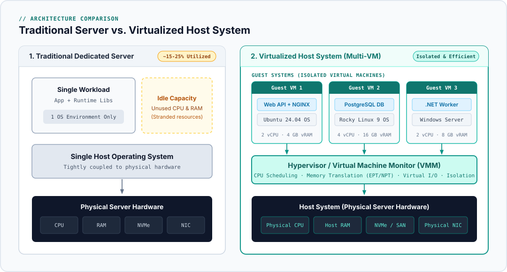
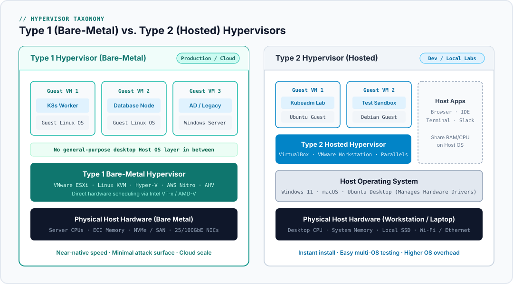
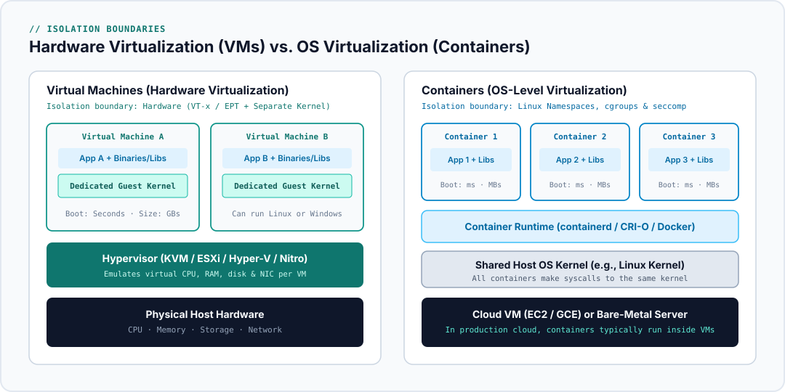

Before virtualization became the standard in data centers, deploying a new application meant provisioning a dedicated physical server for a single operating system and workload. If a database only used 15% of a server's CPU and memory, the remaining 85% sat idle—because running multiple applications on the same operating system risked dependency conflicts, resource contention, and security blast-radius issues.

**Hardware virtualization** solved this fundamental problem and became the backbone of modern cloud computing, local DevOps labs, CI/CD build fleets, and Kubernetes worker nodes. In this guide, we break down what virtualization is, how virtual machines (VMs) and hypervisors work under the hood, the difference between **Type 1** and **Type 2** hypervisors, and how VMs compare with containers in real-world infrastructure.

---

## What Is Virtualization?

**Virtualization** is the process of creating a software-based abstraction layer over physical server hardware—CPU cores, system memory (RAM), storage drives, and network interface cards (NICs)—so a single physical machine can be partitioned into multiple independent, isolated execution environments called **Virtual Machines (VMs)**.

Instead of binding one operating system directly to one physical chassis, virtualization decouples the operating system and applications from the underlying hardware:

- **Higher Hardware Utilization:** Consolidate multiple workloads with different CPU/memory profiles onto a single physical server without stranding idle capacity.
- **Fault & Security Isolation:** A kernel panic, memory leak, or misconfiguration inside one VM does not crash neighboring VMs or the underlying physical server.
- **OS Heterogeneity:** Run Ubuntu Linux, Rocky Linux, and Windows Server simultaneously on the exact same physical x86_64 or ARM64 host.
- **Hardware Portability:** Because a VM's state and disks are encapsulated as files or block volumes, workloads can be snapshotted, cloned, backed up, or live-migrated across physical hosts with near-zero downtime.

---

## What Is a Virtual Machine (VM)?

A **Virtual Machine (VM)** is a software-defined computer that behaves just like a standalone physical machine—complete with its own virtual CPU (`vCPU`), virtual memory (`vRAM`), virtual block storage, virtual network interfaces (`vNIC`), BIOS/UEFI firmware, and full operating system kernel.

When working with virtual machines, infrastructure engineers distinguish between two roles:

- **Host System:** The physical computer or bare-metal server that provides the actual CPU, RAM, storage, and networking hardware.
- **Guest System:** The isolated virtual machine running inside the host, along with its independent **Guest OS** and applications.

### Key Characteristics of Virtual Machines

1. **Dedicated Guest Kernel:** Every VM boots its own kernel (for example, Linux `6.x` on one VM and Windows NT kernel on another), independent of what the host or sibling VMs run.
2. **Hardware-Enforced Isolation:** Modern CPUs isolate guest memory pages and privileged instructions in silicon so one guest cannot read another guest's RAM.
3. **Composable Resource Allocation:** Resources are assigned declaratively (e.g., `4 vCPUs`, `16 GiB RAM`, `100 GiB NVMe`) and can be resized as workload demands change.
4. **Image-Based Lifecycle:** Virtual machines boot from portable disk formats such as **QCOW2** (KVM/QEMU), **VMDK** (VMware), **VDI** (VirtualBox), **VHDX** (Hyper-V), or cloud machine images (**AMIs** on AWS).

> **How Physical Resources Map to a VM:** A `vCPU` typically maps to a hardware CPU thread (hyperthread/SMT) scheduled by the hypervisor onto physical cores. Virtual disks can be **thick-provisioned** (full size reserved upfront for predictable I/O) or **thin-provisioned** (growing dynamically on disk as data is written).

---

## What Is a Hypervisor (Virtual Machine Monitor)?

A **Hypervisor**—also formally known as a **Virtual Machine Monitor (VMM)**—is the specialized software, firmware, or kernel layer responsible for creating, running, scheduling, and isolating virtual machines.

Depending on its architecture, a hypervisor runs either **directly on physical hardware** (Bare-Metal) or **on top of a conventional host operating system** (Hosted). Regardless of type, every hypervisor performs four core jobs:

1. **CPU Scheduling:** Time-slices physical CPU cores across virtual CPUs (`vCPUs`) fairly while enforcing CPU quotas, shares, and NUMA affinity.
2. **Memory Management (SLAT):** Maps Guest Virtual Memory $\rightarrow$ Guest Physical Memory $\rightarrow$ Host Physical Memory using hardware **Second-Level Address Translation** (**Intel EPT** or **AMD RVI/NPT**).
3. **I/O Emulation & Paravirtualization:** Exposes virtual disks and network cards to guests. High-performance production setups use paravirtualized drivers like **`virtio-net`** and **`virtio-blk`** rather than emulating legacy PCI hardware, dramatically reducing I/O latency and CPU overhead.
4. **Privilege & Security Enforcement:** Intercepts sensitive CPU instructions (**VM Exits**) so a guest OS cannot directly manipulate physical hardware registers belonging to the host or other tenants.

### Hardware-Assisted Virtualization (`Intel VT-x` & `AMD-V`)

Early x86 virtualization relied on slow software **binary translation** because the x86 architecture originally expected an OS kernel to run directly in CPU **Ring 0** (most privileged). Modern processors solve this in silicon with **Intel VT-x** (`vmx`) and **AMD-V** (`svm`):

- **VMX Root Operation (Host / Hypervisor Mode):** Full control over physical hardware and virtualization structures.
- **VMX Non-Root Operation (Guest Mode):** Allows the Guest OS kernel to run natively in its own Ring 0 at near-bare-metal speed, trapping into the hypervisor (`VM Exit`) only when executing privileged hardware or I/O operations.

---

## Type 1 vs. Type 2 Hypervisors

Hypervisors are classified into two architectural models—first formalized by Gerald J. Popek and Robert P. Goldberg in 1974—based on where the hypervisor sits relative to physical hardware.

### 1. Type 1 Hypervisor (Bare-Metal / Native)

A **Type 1 hypervisor** installs and executes **directly on the physical host's bare-metal hardware** without an intermediary desktop operating system underneath it. It communicates straight with CPU, memory controllers, storage buses, and network cards.

- **Where It Is Used:** Enterprise data centers, private clouds, telecom infrastructure, and public cloud platforms.
- **Why Production Teams Choose It:** Minimal resource overhead, deterministic latency, smaller security attack surface, and support for enterprise capabilities like live VM migration, SR-IOV hardware passthrough, and high-availability clustering.
- **Popular Examples:**
  - **Linux KVM (Kernel-based Virtual Machine):** Built directly into the mainline Linux kernel (`kvm.ko`), turning Linux itself into a Type 1 hypervisor—typically paired with **QEMU** for device emulation and **`libvirt`** or **Proxmox VE** for management.
  - **AWS Nitro Hypervisor:** Custom lightweight KVM-based bare-metal hypervisor paired with dedicated Nitro ASICs that offload VPC networking, EBS storage, and security.
  - **VMware ESXi (vSphere):** Dedicated bare-metal enterprise hypervisor widely deployed in on-premises data centers.
  - **Microsoft Hyper-V:** Bare-metal hypervisor architecture powering Windows Server virtualization and Microsoft Azure.
  - **Xen / Citrix Hypervisor & Nutanix AHV:** Battle-tested enterprise and cloud hypervisors.

### 2. Type 2 Hypervisor (Hosted)

A **Type 2 hypervisor** runs as a standard **application process on top of an existing Host Operating System** such as Windows 11, macOS, or Ubuntu Desktop. When a VM requests CPU time, memory, or disk I/O, the Type 2 hypervisor delegates hardware access through the underlying host OS kernel and device drivers.

- **Where It Is Used:** Developer laptops, local multi-node Kubernetes labs (such as `kubeadm` with **Vagrant**), cross-platform QA testing, and security sandboxes.
- **Why Developers Choose It:** Installs in minutes alongside everyday desktop apps (IDE, browser, terminal) with broad hardware driver compatibility out of the box.
- **Popular Examples:**
  - **Oracle VirtualBox:** Open-source cross-platform hypervisor widely paired with Vagrant for reproducible local infrastructure labs.
  - **VMware Workstation Pro (Windows/Linux) & VMware Fusion (macOS):** High-performance desktop hypervisors with advanced virtual networking.
  - **Parallels Desktop & UTM:** Popular macOS virtualization platforms (supporting Apple Silicon ARM64 VMs).

### Comparison: Type 1 vs. Type 2 Hypervisors

| Dimension | Type 1 (Bare-Metal) | Type 2 (Hosted) |
| :--- | :--- | :--- |
| **Execution Layer** | Directly on physical server hardware | Runs on top of a Host OS (Windows, macOS, Linux) |
| **Performance & Latency** | Near-native CPU, memory, and I/O speed | Slight extra overhead from Host OS scheduling & I/O path |
| **Security Surface** | Minimal (purpose-built hypervisor layer) | Larger (inherits vulnerabilities & background apps of Host OS) |
| **Scalability** | Hundreds of VMs per host; multi-host HA clusters | Typically 1–10 VMs constrained by workstation RAM/CPU |
| **Setup Experience** | Dedicated host installation & remote management | Installs like any normal desktop application |
| **Primary Use Cases** | Public cloud, production servers, enterprise clusters | Local DevOps labs, OS testing, software development |
| **Common Examples** | Linux KVM, VMware ESXi, Hyper-V, AWS Nitro, AHV | VirtualBox, VMware Workstation/Fusion, Parallels |

---

## Virtual Machines in Public Cloud Platforms

When you launch a cloud instance via Terraform, AWS CLI, or a web console, a fleet orchestration control plane schedules a **Virtual Machine** onto a multi-tenant physical host running a hardened **Type 1 hypervisor**:

| Cloud Service | Compute Unit | Underlying Hypervisor Technology |
| :--- | :--- | :--- |
| **Amazon Web Services (AWS)** | Amazon EC2 Instance | **AWS Nitro System** (custom bare-metal KVM + dedicated Nitro hardware offload cards; legacy generations used Xen) |
| **Microsoft Azure** | Azure Virtual Machine | **Azure Hypervisor** (customized bare-metal Microsoft Hyper-V) |
| **Google Cloud (GCP)** | Compute Engine VM | **Hardened KVM** with custom user-space VMM (`Vanadium` / `crosvm` lineage) and Titanium offload |
| **DigitalOcean** | Droplet | **Linux KVM + QEMU** |

> **Engineering Note on Bare-Metal Cloud Instances:** Cloud providers also offer `.metal` instances (such as `c7g.metal` on AWS EC2). On Nitro-backed metal instances, dedicated Nitro cards still handle VPC networking and EBS block storage in hardware while giving your workload direct, unvirtualized access to physical CPU cores and VT-x/KVM—allowing you to run your own nested hypervisors or microVMs.

---

## Virtual Machines vs. Containers (And Why Production Uses Both)

A common misconception when learning DevOps is that containers *replaced* virtual machines. In reality, VMs and containers operate at **different layers of the stack** and almost always run **together** in production.

- **Virtual Machines virtualize physical hardware:** Each VM runs a full, separate Guest OS kernel on top of a hypervisor. Boot times are measured in seconds, images are hundreds of megabytes to gigabytes, and isolation is enforced by CPU virtualization extensions (`VT-x` / `AMD-V` + `EPT`).
- **Containers virtualize the Operating System:** Multiple containers (managed by `containerd`, `CRI-O`, or `Docker`) **share a single Host Linux Kernel**, using **Linux namespaces** (`pid`, `net`, `mnt`, `uts`, `ipc`, `user`) for visibility isolation and **`cgroups` v2** for CPU/memory resource limits. Containers start in milliseconds with minimal memory overhead—but because they share one kernel, a kernel exploit has a wider theoretical blast radius than a hardware-isolated VM.

### How They Combine in Real Cloud Architectures

1. **Kubernetes on Cloud VMs:** In Amazon EKS, Google GKE, and Azure AKS, **worker nodes are Virtual Machines** providing tenant, network, and kernel boundaries, while **Pods/Containers** run *inside* those VMs for fast application packaging and bin-packing.
2. **MicroVMs (`Firecracker` & `Kata Containers`):** Modern serverless platforms like **AWS Lambda** and **AWS Fargate** use **Firecracker**—an open-source Rust-based VMM built on Linux KVM that boots stripped-down microVMs in **~125 milliseconds** with `< 5 MiB` memory overhead, combining hardware-grade VM security with container-like startup speed.

---

## Key Takeaways

- **Virtualization** abstracts physical CPU, memory, storage, and networking so multiple isolated workloads can safely share a single physical machine.
- A **Virtual Machine (Guest)** runs its own complete OS kernel and user space on top of a **Physical Server (Host)**.
- A **Hypervisor (VMM)** schedules hardware resources and enforces isolation—either **directly on bare metal (Type 1: KVM, ESXi, Hyper-V, AWS Nitro)** for production & cloud workloads, or **on top of a desktop OS (Type 2: VirtualBox, VMware Workstation, Parallels)** for local development and labs.
- **VMs and containers are complementary:** VMs provide strong hardware-level kernel isolation, while containers provide lightweight OS-level packaging inside those VMs.

---

## References & Further Reading

1. **Popek, G. J., & Goldberg, R. P. (1974).** *Formal Requirements for Virtualizable Third Generation Architectures.* Communications of the ACM, 17(7), 412–421 — [dl.acm.org/doi/10.1145/361011.361073](https://dl.acm.org/doi/10.1145/361011.361073)
2. **Linux Kernel Virtual Machine (KVM) Documentation** — Official Linux Kernel KVM API & architecture reference: [linux-kvm.org](https://www.linux-kvm.org/page/Main_Page) & [docs.kernel.org/virt/kvm](https://docs.kernel.org/virt/kvm/index.html)
3. **QEMU & Virtio Architecture Documentation** — Device emulation and paravirtualized `virtio` I/O specification: [qemu.org/docs/master/system](https://www.qemu.org/docs/master/system/index.html)
4. **AWS Nitro System Design Overview** — How AWS offloads virtualization I/O and security to dedicated hardware + lightweight KVM: [aws.amazon.com/ec2/nitro](https://aws.amazon.com/ec2/nitro/)
5. **AWS Firecracker MicroVM Paper (NSDI '20)** — *Firecracker: Lightweight Virtualization for Serverless Applications*: [usenix.org/conference/nsdi20/presentation/agache](https://www.usenix.org/conference/nsdi20/presentation/agache)
6. **NIST Special Publication 800-125** — *Guide to Security for Full Virtualization Technologies*: [csrc.nist.gov/pubs/sp/800/125/final](https://csrc.nist.gov/pubs/sp/800/125/final)
7. **Red Hat Enterprise Linux — Configuring and Managing Virtualization** — Practical engineering guide to KVM, QEMU, and `libvirt`: [docs.redhat.com/en/documentation/red_hat_enterprise_linux/9](https://docs.redhat.com/en/documentation/red_hat_enterprise_linux/9)
