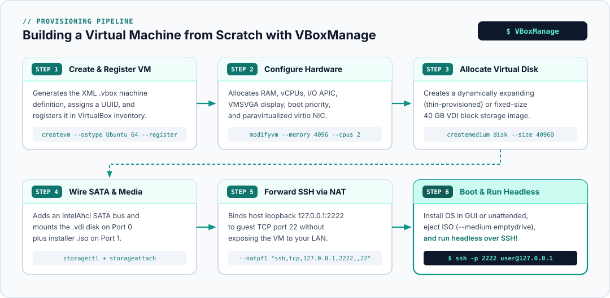
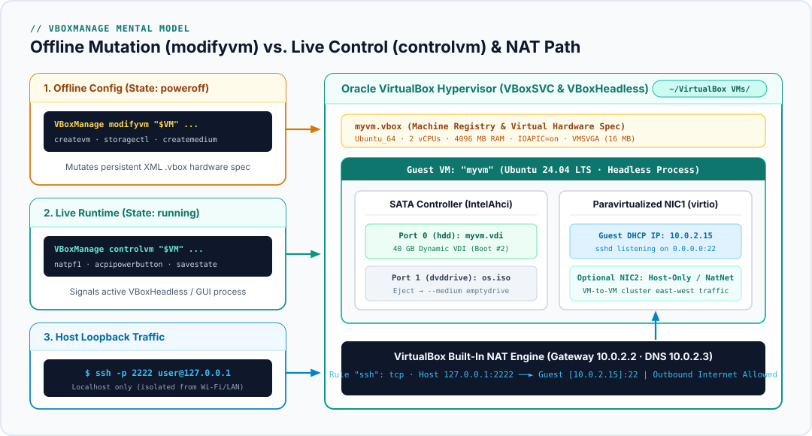

Clicking through the VirtualBox desktop GUI is fine when testing a one-off desktop ISO, but GUI wizards break down the moment you need repeatable infrastructure: provisioning VMs over SSH on a headless Linux server, building golden images in CI pipelines, scripting disposable multi-node labs, or debugging what higher-level tools like **HashiCorp Vagrant** and **Packer** execute behind the scenes.

Every single feature exposed in the VirtualBox graphical interface—plus dozens of advanced storage, networking, bandwidth, and telemetry controls that never appear in the GUI—is driven by a single command-line binary: **`VBoxManage`**.

In this guide, we walk through provisioning a production-ready Linux virtual machine end-to-end from the terminal, dissect how `VBoxManage` separates offline hardware configuration (`modifyvm`) from live runtime control (`controlvm`), configure secure NAT port forwarding and multi-VM networks, and cover essential day-2 operations including snapshots, linked clones, headless execution, and clean teardown.

> **Related Foundations:** New to Type 1 vs. Type 2 hypervisors, paravirtualized `virtio` drivers, or declarative VM automation? Pair this guide with [Virtualization, Virtual Machines, and Hypervisors: A Practical Guide](https://blog.mahinraza.online/posts/2026-11-17-virtualization-virtualMachine-and-hypervisor/) and [Vagrant Guide: Architecture, Installation, and Launching Your First VM](https://blog.mahinraza.online/posts/2026-11-17-vagrant-guide-part-1-architecture-installation-and-launching-your-first-vm/).

---

## Quick Start: Provision a Complete Linux VM in 20 Lines

If you already have VirtualBox installed and an Ubuntu Server `.iso` downloaded locally, the self-contained Bash script below creates, configures, networks, and boots a `2 vCPU` / `4 GiB RAM` / `40 GiB Disk` virtual machine with localhost SSH port forwarding in seconds:

```bash
#!/usr/bin/env bash
set -euo pipefail

VM="myvm"
ISO="$HOME/Downloads/ubuntu-24.04-live-server-amd64.iso"
VM_DIR="$HOME/VirtualBox VMs/$VM"

# 1. Create and register the VM shell
VBoxManage createvm --name "$VM" --ostype Ubuntu_64 --register

# 2. Configure CPU, RAM, GPU, firmware/APIC, boot priority, and paravirtualized NIC
VBoxManage modifyvm "$VM" \
  --memory 4096 --cpus 2 --ioapic on \
  --vram 16 --graphicscontroller vmsvga \
  --boot1 dvd --boot2 disk --boot3 none --boot4 none \
  --nic1 nat --nictype1 virtio --cableconnected1 on \
  --rtcuseutc on

# 3. Allocate a thin-provisioned 40 GiB VDI virtual disk
VBoxManage createmedium disk \
  --filename "$VM_DIR/$VM.vdi" \
  --size 40960 --format VDI

# 4. Attach a SATA AHCI storage controller and wire the HDD + installer ISO
VBoxManage storagectl "$VM" --name SATA --add sata --controller IntelAhci --portcount 2
VBoxManage storageattach "$VM" --storagectl SATA --port 0 --device 0 --type hdd --medium "$VM_DIR/$VM.vdi"
VBoxManage storageattach "$VM" --storagectl SATA --port 1 --device 0 --type dvddrive --medium "$ISO"

# 5. Forward Host 127.0.0.1:2222 -> Guest TCP port 22 for SSH
VBoxManage modifyvm "$VM" --natpf1 "ssh,tcp,127.0.0.1,2222,,22"

# 6. Boot with GUI for the initial OS installation (switch to --type headless afterward)
VBoxManage startvm "$VM" --type gui
```



Let's understand the architecture behind `VBoxManage` and break down every flag and lifecycle stage in detail.

---

## Core Mental Model: `modifyvm` vs. `controlvm`

Before memorizing flags, there is one architectural rule in VirtualBox that saves hours of troubleshooting: **`VBoxManage` strictly separates offline hardware mutation from live runtime control.**



When you run any `VBoxManage` command, the CLI communicates via IPC/COM with **`VBoxSVC`**—the background VirtualBox service daemon that owns the machine registry (`VirtualBox.xml`) and each VM's `.vbox` XML definition file:

1. **Offline Configuration (`VBoxManage modifyvm`, `storagectl`, `createmedium`):**
   - Works **only while the VM is powered off** (`State: powered off`).
   - Mutates virtual motherboard settings (RAM size, CPU cores, NIC adapter mode, boot order, storage buses) directly inside `myvm.vbox`.
   - Running `modifyvm` against an active VM immediately fails with `VBOX_E_INVALID_VM_STATE: The machine is not mutable (state is Running)`.
2. **Live Runtime Control (`VBoxManage controlvm`):**
   - Works **only while the VM is actively running** (`State: running` or `paused`).
   - Sends live signals to the active `VBoxHeadless` or GUI hypervisor process—such as adding/removing NAT port forwards on the fly, pressing the virtual ACPI power button, unplugging a virtual network cable, or hibernating RAM state to disk.

### Essential `VBoxManage` Subcommand Map

| Subcommand | Required VM State | Primary Responsibility |
| :--- | :--- | :--- |
| **`list`** | Any | Query global host state (`vms`, `runningvms`, `ostypes`, `bridgedifs`, `hostonlyifs`, `natnets`, `hdds`). |
| **`showvminfo`** | Any | Inspect complete hardware, storage, network, and runtime telemetry for a VM (by name or UUID). |
| **`createvm`** | N/A | Generate a new `.vbox` machine XML file and optionally register it in VirtualBox's inventory. |
| **`modifyvm`** | Powered Off | Configure CPU, RAM, firmware, GPU, boot order, audio, USB, and network adapters. |
| **`createmedium`** | Any | Create standalone virtual disks (`VDI`, `VMDK`, `VHD`), ISOs, or floppy images. |
| **`storagectl`** | Powered Off | Add, modify, or remove virtual storage buses (`SATA`, `NVMe`, `VirtIO`, `IDE`, `SCSI`). |
| **`storageattach`** | Off *(DVD live OK)* | Plug `.vdi` hard disks or `.iso` optical media into specific controller ports (or eject media). |
| **`startvm`** | Powered Off / Saved | Boot a VM in `gui`, `headless`, or `separate` (detachable UI) mode. |
| **`controlvm`** | Running / Paused | Trigger ACPI shutdown, hard poweroff, pause/resume, live NAT rules, or link-state changes. |
| **`snapshot`** | Off or Running | Capture, list, restore, or delete point-in-time disk + memory state checkpoints. |
| **`clonevm`** | Powered Off | Create full independent copies or instant Copy-on-Write linked clones of a golden VM. |
| **`unattended`** | Powered Off | Automate zero-touch OS installations (Ubuntu Preseed/Subiquity, RHEL Kickstart, Windows XML). |
| **`unregistervm`** | Powered Off | Remove a VM from inventory—and permanently delete all attached disks when `--delete` is passed. |

### Cross-Platform CLI Setup Check

On **Linux** and **macOS**, the installer places both `VBoxManage` and a lowercase `vboxmanage` symlink onto `/usr/bin` or `/usr/local/bin` automatically. On **Windows**, `VBoxManage.exe` lives outside the default system `PATH`—add it once in PowerShell if needed:

```powershell
# Windows PowerShell: verify VBoxManage and add to user PATH if missing
$vboxDir = "C:\Program Files\Oracle\VirtualBox"
if (($env:Path -split ';') -notcontains $vboxDir) {
  [Environment]::SetEnvironmentVariable("Path", "$env:Path;$vboxDir", "User")
  $env:Path += ";$vboxDir"
}
VBoxManage --version
```

---

## Step-by-Step Breakdown: Provisioning a VM from Scratch

Every VM can be addressed in `VBoxManage` by either its **human-readable name** (`"myvm"`) or its immutable **UUID**. Using shell variables at the top of your script keeps every subsequent command clean and reusable:

```bash
VM="myvm"
ISO="/path/to/ubuntu-24.04-live-server-amd64.iso"
VM_DIR="$HOME/VirtualBox VMs/$VM"
```

### Step 1: Discover Guest OS Profiles & Register the VM (`createvm`)

VirtualBox maintains built-in hardware presets (recommended chipset, audio, pointer device, and 32/64-bit CPU expectations) for dozens of operating systems. You can query the exact OS identifier before creating a machine:

```bash
# List all supported 64-bit Linux OS type IDs
VBoxManage list ostypes | grep -E "ID:|Description:" | grep -A1 -iE "ubuntu|debian|redhat|linux"
```

Common modern `ostype` IDs include `Ubuntu_64`, `Ubuntu24_LTS_64` (VirtualBox `7.1+`), `Debian_64`, `RedHat_64` (RHEL / Rocky / AlmaLinux), `ArchLinux_64`, and `Windows11_64`.

Now create and register the empty VM container:

```bash
VBoxManage createvm --name "$VM" --ostype Ubuntu_64 --register
```

- **`--name "$VM"`:** Sets the display name and creates the machine directory `~/VirtualBox VMs/myvm/` containing `myvm.vbox`. *(Use `--basefolder "/mnt/nvme-vms"` if you want to store VMs on a secondary fast SSD.)*
- **`--ostype Ubuntu_64`:** Applies sensible 64-bit Ubuntu defaults.
- **`--register`:** Immediately adds the VM to VirtualBox's active inventory (`~/.config/VirtualBox/VirtualBox.xml`). Without `--register`, the `.vbox` file is written to disk, and you would have to run `VBoxManage registervm` manually before `list vms` can see it.

### Step 2: Configure Virtual Hardware (`modifyvm`)

An empty registered VM starts with minimal defaults (often `1 vCPU` and small RAM). Configure compute, display, firmware, boot order, and networking in a single atomic `modifyvm` call:

```bash
VBoxManage modifyvm "$VM" \
  --memory 4096 \
  --cpus 2 \
  --ioapic on \
  --vram 16 \
  --graphicscontroller vmsvga \
  --boot1 dvd --boot2 disk --boot3 none --boot4 none \
  --nic1 nat --nictype1 virtio --cableconnected1 on \
  --rtcuseutc on
```

Why each hardware flag matters:

- **`--memory 4096`:** Allocates `4096 MiB` (`4 GiB`) of host RAM to the guest. Keep total allocated VM memory comfortably below ~75% of your physical host RAM to avoid host swap thrashing.
- **`--cpus 2`:** Assigns 2 virtual CPU cores. As a rule of thumb on Type 2 hypervisors, assign physical core counts rather than hyperthreaded logical counts for latency-sensitive workloads.
- **`--ioapic on`:** Enables the **I/O Advanced Programmable Interrupt Controller**. **Required** whenever you assign more than 1 vCPU (`SMP`) or run modern 64-bit operating systems so hardware interrupts route cleanly across cores.
- **`--vram 16 --graphicscontroller vmsvga`:** Emulates the VMware SVGA II virtual GPU (`vmsvga`), which is VirtualBox's recommended controller for Linux guests (supported natively by mainline Linux kernel `vmwgfx` DRM drivers). Bump `--vram 128` if running a desktop GUI with Wayland/X11; `16` MB is plenty for headless servers. *(Use `vboxsvga` for Windows 10/11 guests.)*
- **`--boot1 dvd --boot2 disk --boot3 none --boot4 none`:** Tries the optical DVD drive first (so an empty disk boots straight into the OS installer) and falls back to the virtual hard disk, skipping legacy floppy and PXE network boot timeouts.
- **`--nic1 nat --nictype1 virtio`:** Connects Adapter 1 to VirtualBox's built-in NAT router using a **paravirtualized `virtio-net` interface**. Unlike emulated Intel PCI cards (`82540EM`), `virtio` bypasses expensive hardware register emulation—delivering higher throughput and lower CPU overhead on any modern Linux kernel. *(For Windows guests without preloaded VirtIO drivers, use `--nictype1 82540EM` instead.)*
- **`--cableconnected1 on`:** Ensures the virtual Ethernet link carrier is plugged in (`UP`).
- **`--rtcuseutc on`:** Sets the virtual Real-Time Clock to UTC, matching standard Linux server expectations and preventing timezone clock skew after host sleep/wake cycles.

> **Optional UEFI Boot (`--firmware efi`):** By default, VirtualBox boots legacy BIOS (`--firmware bios`). If your guest image or partitioning layout requires UEFI (such as Windows 11, Secure Boot tests, or ARM64 guests on Apple Silicon), add `--firmware efi`.

### Step 3: Create the Virtual Hard Disk (`createmedium disk`)

Virtual machines store root filesystems inside portable virtual disk files:

```bash
VBoxManage createmedium disk \
  --filename "$HOME/VirtualBox VMs/$VM/$VM.vdi" \
  --size 40960 \
  --format VDI
```

- **`--filename`:** Target path for the `.vdi` file inside the VM's folder (always quote paths because `"VirtualBox VMs"` contains a space!).
- **`--size 40960`:** Maximum logical disk capacity in **megabytes (`MiB`)**—`40960 MiB = 40 GiB`.
- **`--format VDI`:** VirtualBox Disk Image, VirtualBox's native block format (also supports `VMDK` for VMware compatibility and `VHD` for Hyper-V/Azure).
- **Thin vs. Thick Provisioning (`--variant`):** By default (`--variant Standard`), VirtualBox creates a **dynamically allocated (thin-provisioned)** file—a `40 GiB` disk consumes only a few megabytes on your host SSD initially and grows only as the guest writes blocks. For write-heavy database benchmarks where you want zero allocation latency, pass `--variant Fixed` to preallocate all `40 GiB` upfront.

Need to grow a dynamic VDI later without rebuilding the VM? While powered off, resize the medium and then expand the partition inside Linux (`growpart` + `resize2fs` / `lvextend`):

```bash
# Expand an existing VDI disk from 40 GiB to 80 GiB (81920 MiB)
VBoxManage modifymedium disk "$HOME/VirtualBox VMs/$VM/$VM.vdi" --resize 81920
```

### Step 4: Add a Storage Controller (`storagectl`)

Just like a physical motherboard needs an AHCI SATA or NVMe controller before you can plug in drives, VirtualBox separates **storage controllers** from **storage media**:

```bash
VBoxManage storagectl "$VM" \
  --name SATA \
  --add sata \
  --controller IntelAhci \
  --portcount 2 \
  --hostiocache on
```

- **`--name SATA`:** User-defined label for this controller bus—referenced by `storageattach` in the next step.
- **`--add sata --controller IntelAhci`:** Emulates a standard Intel ICH8M/AHCI SATA bus supported natively by every modern OS without extra drivers. *(Up to 30 ports are supported; setting `--portcount 2` trims unused AHCI port polling during boot.)*
- **`--hostiocache on`:** Allows VirtualBox to leverage the host OS page cache for asynchronous disk I/O, noticeably speeding up `apt`/`dnf` package extraction on developer laptops.

### Step 5: Attach the Hard Disk and Installer ISO (`storageattach`)

Now plug the `.vdi` disk into SATA **Port 0** and insert the OS `.iso` into a virtual DVD drive on **Port 1**:

```bash
# Port 0: Primary bootable virtual hard disk
VBoxManage storageattach "$VM" \
  --storagectl SATA --port 0 --device 0 \
  --type hdd --medium "$HOME/VirtualBox VMs/$VM/$VM.vdi"

# Port 1: Virtual optical drive loaded with the OS installer ISO
VBoxManage storageattach "$VM" \
  --storagectl SATA --port 1 --device 0 \
  --type dvddrive --medium "$ISO"
```

- **`--port 0` / `--port 1`:** Slot index on the `SATA` controller.
- **`--device 0`:** Device index on that port (SATA is point-to-point, so `--device` is **always `0`**; only legacy primary/secondary IDE buses used `0` for Master and `1` for Slave).
- **`--type hdd` / `--type dvddrive`:** Tells the guest OS whether the block device behaves like a read/write disk or removable optical media.

### Step 6: Boot, Install the OS & Eject the ISO (`startvm`)

VirtualBox supports three launch modes via `VBoxManage startvm`:

```bash
# Option A: Open a desktop console window (use this for interactive OS installation)
VBoxManage startvm "$VM" --type gui

# Option B: Run in the background with zero GUI window (ideal once SSH is working)
VBoxManage startvm "$VM" --type headless

# Option C: Run background VM process with a detachable GUI window you can close safely
VBoxManage startvm "$VM" --type separate
```

- **First Boot Tip:** Start with `--type gui` on the initial boot so you can complete the interactive OS installer (and be sure to check **"Install OpenSSH server"** during Ubuntu Server setup!).
- **Zero-Touch Alternative (`VBoxManage unattended`):** On headless Linux build servers with no X11/Wayland display at all, VirtualBox can even generate preseed/autoinstall media and install Ubuntu or Debian completely hands-free:

```bash
VBoxManage unattended install "$VM" \
  --iso="$ISO" \
  --user=devops --password="ChangeMeNow!" \
  --full-user-name="DevOps Lab" \
  --hostname="myvm.local" \
  --install-additions \
  --start-vm=headless
```

#### Post-Install: Eject the Installer ISO

Once installation finishes and the VM powers down (or before rebooting if `--boot1 dvd` is still first in your boot order), swap the DVD slot to `emptydrive` so the VM boots straight into your newly installed OS disk:

```bash
VBoxManage storageattach "$VM" \
  --storagectl SATA --port 1 --device 0 \
  --type dvddrive --medium emptydrive
```

*(Unlike `modifyvm`, ejecting or swapping a `dvddrive` with `storageattach --medium emptydrive` works even while the VM is running—just add `--forceunmount` if the guest OS locked the tray.)*

---

## Networking & Port Forwarding Deep Dive

By default, `--nic1 nat` places the VM behind an isolated per-VM virtual router:

| NAT Parameter | Default Value (Adapter 1) | Behavior |
| :--- | :--- | :--- |
| **NAT Subnet** | `10.0.2.0/24` | Private to this single VM (two VMs both get `10.0.2.15` independently and **cannot** ping each other). |
| **Guest DHCP IP** | `10.0.2.15` | Assigned automatically by VirtualBox's built-in DHCP server. |
| **Virtual Gateway / Host Alias** | `10.0.2.2` | Default route to the internet; also reaches services listening on your **Host** machine! |
| **Built-In DNS Proxy** | `10.0.2.3` | Forwards guest DNS queries through the host's configured resolvers. |

Because NAT translates outbound packets (`VM → Internet`) while dropping unsolicited inbound connections (`Host → VM`), you expose specific guest services like `sshd` (`:22`) or HTTP (`:80`) using **NAT port-forwarding rules**.

### Anatomy of a Port-Forwarding Rule (`--natpf1`)

Every `--natpf<N>` rule (where `<N>` matches adapter `1`–`8`) uses a strict 6-field comma-separated string:

```text
"name,protocol,hostip,hostport,guestip,guestport"
```

Let's break down our SSH rule `"ssh,tcp,127.0.0.1,2222,,22"` field by field:

1. **`ssh` (`name`):** Unique descriptive label used to inspect or delete this rule later.
2. **`tcp` (`protocol`):** Transport protocol (`tcp` or `udp`).
3. **`127.0.0.1` (`hostip`):** Host interface IP to bind. **Security best practice:** Always set `127.0.0.1` for local labs so only your workstation can connect. Leaving `hostip` empty (`"ssh,tcp,,2222,,22"`) binds `0.0.0.0:2222` on **all** host interfaces—exposing your VM's SSH port to anyone on shared office or coffee-shop Wi-Fi!
4. **`2222` (`hostport`):** Unprivileged TCP port on the host (`> 1024`, so VirtualBox doesn't need root privileges on Linux/macOS).
5. *(Empty)* **(`guestip`):** Leaving the fifth field blank (`,,`) instructs VirtualBox to forward to whatever DHCP IP the guest holds on that NAT engine (`10.0.2.15`).
6. **`22` (`guestport`):** Target port inside the Linux guest (`sshd`).

Connect from your host terminal (passing `-o StrictHostKeyChecking=accept-new` or `-o UserKnownHostsFile=/dev/null` if you frequently rebuild disposable VMs on port `2222`):

```bash
ssh -p 2222 user@127.0.0.1
```

### Offline vs. Live Port Forwarding (Adding & Deleting Rules)

Remember the `modifyvm` vs. `controlvm` split—you can manage port-forwarding rules in **both** states using slightly different syntax:

```bash
# ==========================================================
# WHEN VM IS POWERED OFF (persists in .vbox)
# ==========================================================
VBoxManage modifyvm "$VM" --natpf1 "ssh,tcp,127.0.0.1,2222,,22"
VBoxManage modifyvm "$VM" --natpf1 "http,tcp,127.0.0.1,8080,,80"

# Delete a rule by name while powered off
VBoxManage modifyvm "$VM" --natpf1 delete "http"

# ==========================================================
# WHEN VM IS RUNNING LIVE (takes effect immediately, zero reboot!)
# ==========================================================
VBoxManage controlvm "$VM" natpf1 "api,tcp,127.0.0.1,3000,,3000"

# Delete a rule live on a running VM
VBoxManage controlvm "$VM" natpf1 delete "api"
```

### Multi-VM Networking: NAT Network & Host-Only Patterns

Standard `--nic1 nat` isolates every VM inside its own standalone `10.0.2.0/24` bubble. When building multi-node labs (such as a `kubeadm` cluster, Ansible target fleet, or app + database pair), choose one of two topologies:

#### Pattern A: Shared `NAT Network` (VM-to-VM + Outbound Internet on 1 NIC)

A **NAT Network** creates a shared virtual switch with a single NAT gateway so multiple VMs receive unique `10.0.2.x` addresses, talk directly to each other east-west, and reach the internet:

```bash
# Create a shared NAT Network once on the host
VBoxManage natnetwork add \
  --netname lab-natnet \
  --network "10.0.2.0/24" \
  --enable --dhcp on

# Attach multiple VMs (while powered off) to the same NAT Network
VBoxManage modifyvm "node-01" --nic1 natnetwork --nat-network1 lab-natnet --nictype1 virtio
VBoxManage modifyvm "node-02" --nic1 natnetwork --nat-network1 lab-natnet --nictype1 virtio
```

*(Note: On a shared `natnetwork`, port-forwarding rules belong to the network rather than an individual VM and must specify the target guest IP explicitly: `VBoxManage natnetwork modify --netname lab-natnet --port-forward-4 "ssh-node1:tcp:[127.0.0.1]:2201:[10.0.2.4]:22"`.)*

#### Pattern B: Dual-NIC `NAT + Host-Only` (The Standard DevOps Lab Pattern)

Keep **NIC 1 as `nat`** (for effortless outbound internet and package installs) and add **NIC 2 as `hostonly`** so your host and all VMs share a private `192.168.56.0/24` LAN with static IPs—no port-forwarding rules required:

```bash
# Create host-only interface vboxnet0 (192.168.56.1/24 by default) if not already present
VBoxManage hostonlyif create
VBoxManage hostonlyif ipconfig vboxnet0 --ip 192.168.56.1 --netmask 255.255.255.0

# Attach NIC 2 to vboxnet0 while keeping NIC 1 on NAT
VBoxManage modifyvm "$VM" --nic2 hostonly --hostonlyadapter2 vboxnet0 --nictype2 virtio
```

---

## Day-2 Lifecycle Operations: Power, Snapshots, Cloning & Cleanup

Once your VM is up and running headless, these `VBoxManage` workflows cover 99% of daily engineering tasks.

### 1. Inspecting Inventory & Machine-Readable State

```bash
# List all registered VMs ("name" {uuid})
VBoxManage list vms

# List only actively running VMs
VBoxManage list runningvms

# Dump script-friendly key=value state (great for Bash/CI scripts!)
VBoxManage showvminfo "$VM" --machinereadable | grep -E '^(VMState=|memory=|cpus=|nic1=|Forwarding)'

# Query live guest IP address from the host (requires VirtualBox Guest Additions inside guest)
VBoxManage guestproperty get "$VM" "/VirtualBox/GuestInfo/Net/0/V4/IP"
```

### 2. Graceful vs. Hard Power Control (`controlvm`)

Avoid killing headless VMs with `poweroff` unless the guest kernel is hung—`poweroff` yanks the virtual power cord and risks ext4/XFS journal corruption. Send an ACPI shutdown signal first:

```bash
# Clean OS shutdown (equivalent to pressing physical power button; systemd runs clean stop)
VBoxManage controlvm "$VM" acpipowerbutton

# Freeze exact RAM & CPU state to disk and stop consuming host memory (resumes in ~2s via startvm)
VBoxManage controlvm "$VM" savestate

# Pause / unpause CPU execution in-place (RAM remains allocated)
VBoxManage controlvm "$VM" pause
VBoxManage controlvm "$VM" resume

# Hard reset or hard power cut (use only if guest OS is unresponsive)
VBoxManage controlvm "$VM" reset
VBoxManage controlvm "$VM" poweroff
```

### 3. Point-in-Time Snapshots (`snapshot`)

Before testing risky kernel upgrades, `iptables`/`nftables` rules, or cluster bootstrap scripts, take a snapshot so you can roll back in three seconds:

```bash
# Take a live or offline snapshot with a description
VBoxManage snapshot "$VM" take "clean-ubuntu-base" --description "Fresh 24.04 + OpenSSH before K8s packages" --live

# View the snapshot tree
VBoxManage snapshot "$VM" list

# Roll back to a snapshot (VM must be powered off or saved first)
VBoxManage controlvm "$VM" poweroff
VBoxManage snapshot "$VM" restore "clean-ubuntu-base"
VBoxManage startvm "$VM" --type headless

# Delete an old snapshot (merges differencing disk blocks back cleanly)
VBoxManage snapshot "$VM" delete "clean-ubuntu-base"
```

### 4. Fast Golden-Image Cloning (`clonevm`) & OVA Appliances

Instead of sitting through a 10-minute ISO installation every time you need a new Linux node, keep one clean `"ubuntu-golden"` VM powered off (with a snapshot taken) and spin up **linked clones** in under two seconds using Copy-on-Write differencing disks:

```bash
# Prepare a snapshot on your powered-off golden template VM
VBoxManage snapshot "ubuntu-golden" take "golden-v1"

# Spin up an instant Linked Clone (uses minimal disk space; regenerates MAC addresses!)
VBoxManage clonevm "ubuntu-golden" \
  --snapshot "golden-v1" \
  --options link \
  --name "k8s-worker-01" \
  --macaddress-policy generate \
  --register

# Or create a completely independent Full Clone
VBoxManage clonevm "ubuntu-golden" \
  --mode machine \
  --name "standalone-db-01" \
  --macaddress-policy generate \
  --register
```

> **Linux Cloned VM Tip:** After booting a cloned Ubuntu/Debian VM that uses DHCP, reset `/etc/machine-id` (`sudo truncate -s 0 /etc/machine-id && sudo systemd-machine-id-setup`) and regenerate SSH host keys (`sudo ssh-keygen -A`) so DHCP servers using RFC 4361 client identifiers don't hand identical IPs to two clones!

To share a VM across machines or import pre-built cloud/appliance images (`.ova` / `.ovf`):

```bash
# Export a powered-off VM into a single portable .ova archive
VBoxManage export "$VM" --output "$HOME/$VM-appliance.ova"

# Preview import options first, then import the .ova into VirtualBox
VBoxManage import "$HOME/$VM-appliance.ova" --dry-run
VBoxManage import "$HOME/$VM-appliance.ova" --vsys 0 --vmname "imported-vm"
```

### 5. Clean Teardown Without Orphaned Disks (`unregistervm`)

```bash
# Ensure the VM is stopped, then remove it AND delete its .vbox + .vdi files from disk
VBoxManage controlvm "$VM" poweroff 2>/dev/null || true
VBoxManage unregistervm "$VM" --delete
```

*(Omitting `--delete` unregisters the VM from VirtualBox's list while leaving its `.vdi` disk files intact inside `~/VirtualBox VMs/`.)*

---

## Common `VBoxManage` Errors & Fast Fixes

| Error / Symptom | Root Cause | Exact CLI Fix |
| :--- | :--- | :--- |
| `VBOX_E_INVALID_VM_STATE: The machine is not mutable` | Ran `modifyvm` or `storagectl` while VM is `running` or in `saved` state. | Shut down first (`VBoxManage controlvm "$VM" acpipowerbutton`), discard saved state (`VBoxManage discardstate "$VM"`), or use `controlvm` for live changes. |
| `Cannot register the hard disk ... UUID already exists` | Copied a `.vdi` file manually with `cp`, duplicating its internal header UUID. | Assign a fresh disk UUID (`VBoxManage internalcommands sethduuid copied.vdi`)—or use `VBoxManage clonevm` / `clonemedium` instead of `cp`. |
| `ssh -p 2222 user@127.0.0.1` hangs or refuses connection | `openssh-server` isn't running inside the guest, guest `ufw` blocks `:22`, or wrong NIC has the rule. | Verify the rule (`VBoxManage showvminfo "$VM" \| grep Rule`), open GUI console once, and run `sudo apt install -y openssh-server && sudo systemctl enable --now ssh`. |
| Guest has NAT IP `10.0.2.15` but `apt update` / DNS stalls | Corporate VPN or split-DNS on the host breaks VirtualBox's default `10.0.2.3` DNS proxy. | Route guest DNS lookups directly through your host OS resolver: `VBoxManage modifyvm "$VM" --natdnshostresolver1 on`. |
| `Kernel driver not installed (rc=-1908)` on Linux | Host Linux kernel updated without rebuilding `vboxdrv` DKMS modules (or Secure Boot blocked unsigned module). | Run `sudo /sbin/vboxconfig` and enroll MOK keys if UEFI Secure Boot is enabled. |
| `E_ACCESSDENIED` creating Host-Only subnet outside `192.168.56.0/21` | VirtualBox `6.1.28+` restricts non-default host-only CIDR ranges on Linux/macOS for security. | Whitelist desired CIDRs in `/etc/vbox/networks.conf` (e.g., `echo "* 10.0.0.0/8 192.168.0.0/16" \| sudo tee -a /etc/vbox/networks.conf`). |

---

## Key Takeaways

- **`VBoxManage` is the complete automation surface for VirtualBox:** Everything from VM creation (`createvm`), SATA/NVMe buses (`storagectl`), and thin-provisioned disks (`createmedium`) to headless servers (`startvm --type headless`) can be scripted deterministically in Bash or PowerShell.
- **Respect the `modifyvm` vs. `controlvm` boundary:** Use `modifyvm` to edit persistent `.vbox` hardware settings when the VM is powered off, and `controlvm` to adjust NAT port forwards, link states, or ACPI power on a live running VM.
- **Choose paravirtualized drivers and localhost bindings:** Pairing `--nictype1 virtio` with `--ioapic on` maximizes Linux guest performance, while binding NAT rules explicitly to `127.0.0.1` (`--natpf1 "ssh,tcp,127.0.0.1,2222,,22"`) keeps local labs isolated from untrusted networks.
- **Snapshots and Linked Clones accelerate lab iteration:** Instead of reinstalling from ISO repeatedly, snapshot a clean golden VM once and spawn multi-node labs in seconds via `VBoxManage clonevm --options link`.

---

## References & Further Reading

1. **Oracle VirtualBox Official User Manual — Chapter 8: `VBoxManage` Reference** — Complete authoritative specification of every `VBoxManage` subcommand and flag: [virtualbox.org/manual/topics/vboxmanage.html](https://www.virtualbox.org/manual/topics/vboxmanage.html)
2. **Oracle VirtualBox Networking Modes & NAT Engine Documentation** — Deep dive into NAT port forwarding, NAT Networks, Host-Only, and Bridged adapters: [virtualbox.org/manual/topics/networkingdetails.html](https://www.virtualbox.org/manual/topics/networkingdetails.html)
3. **Linux Kernel `virtio` Paravirtualized I/O Drivers** — How `virtio-net` and `virtio-blk` eliminate PCI hardware emulation overhead: [docs.kernel.org/driver-api/virtio](https://docs.kernel.org/driver-api/virtio/virtio.html)
4. **Packer VirtualBox Builder (`virtualbox-iso` / `virtualbox-ovf`)** — How HashiCorp Packer orchestrates `VBoxManage` commands to build automated golden machine images: [developer.hashicorp.com/packer/integrations/hashicorp/virtualbox](https://developer.hashicorp.com/packer/integrations/hashicorp/virtualbox)
