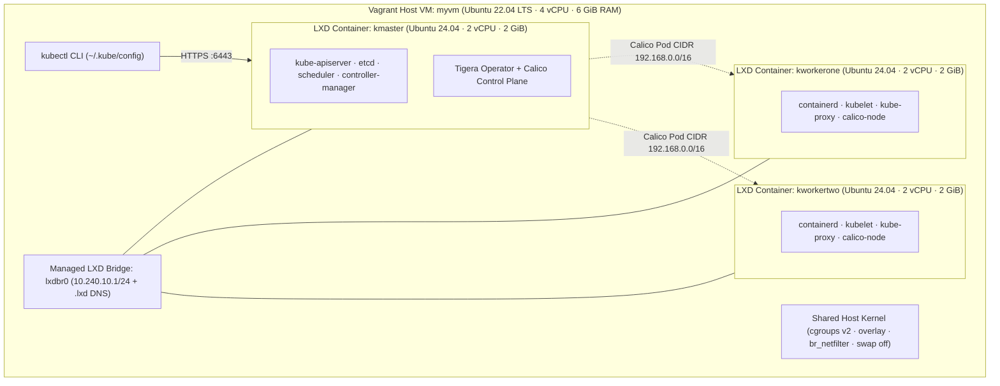

Spinning up a multi-node `kubeadm` Kubernetes cluster with traditional virtual machines typically consumes **8–12 GiB of static RAM** and several minutes of hypervisor boot overhead. **LXC/LXD system containers** eliminate that hypervisor tax: every node boots a complete Ubuntu `24.04 LTS` OS userland (`systemd`, `containerd`, `kubelet`, `sshd`) in under two seconds while sharing a single Linux host kernel dynamically.

In this hands-on guide, you will build a **3-node Kubernetes `v1.36` cluster** (`1` control-plane node + `2` worker nodes) inside Ubuntu `24.04` LXD system containers with **Calico `v3.33.0` CNI**—automated end-to-end with Vagrant and Bash scripts so the entire lab comes up in a single `vagrant up`.

> **Lab & Development Scope:** Running `kubeadm` and `containerd` inside LXD system containers requires privileged nesting (`security.privileged=true` and `security.nesting=true`), which weakens host-to-container isolation. This architecture is ideal for **local development, CKA/CKAD study labs, and CI testing**, not multi-tenant production workloads.
>
> **Related LXD Guides:** New to LXD system containers, profiles, or bridge networking? Pair this tutorial with the [LXC and LXD System Containers Series](/posts/2026-11-23-lxc-and-lxd-system-containers-guide/), [Installing and Initializing LXD on Linux](/posts/2026-11-22-lxd-installation-and-initialization-guide/), and [LXD Profiles Guide](/posts/2026-11-22-lxd-profiles-guide/).

---

## Cluster Architecture & Lab Specifications

Instead of running three separate VirtualBox VMs, a single Ubuntu `22.04 LTS` host VM (`myvm`) runs the **LXD `5.21 LTS` daemon** and hosts all three Kubernetes nodes on the managed `lxdbr0` NAT bridge (`10.240.10.0/24`):



| Layer | Specification | Details |
| :--- | :--- | :--- |
| **Host Machine / VM** | Ubuntu `22.04 LTS` (`4 vCPU`, `6 GiB RAM`) | Provisioned via Vagrant + VirtualBox (or an AWS `t3.large` EC2 instance) |
| **Container Manager** | LXD `5.21/stable` LTS | `dir` storage pool + `lxdbr0` NAT bridge (`10.240.10.1/24`) |
| **Node OS** | Ubuntu `24.04 LTS` (`ubuntu:24.04`) | `kmaster`, `kworkerone`, `kworkertwo` (`2 vCPU` / `2 GiB RAM` cap each) |
| **Container Runtime** | `containerd.io` (`SystemdCgroup = true`) | Official Docker/containerd APT repository |
| **Kubernetes Version** | `v1.36` (`kubeadm`, `kubelet`, `kubectl`) | Official `pkgs.k8s.io` repository |
| **Pod Network (CNI)** | Project Calico `v3.33.0` | Tigera Operator with `192.168.0.0/16` Pod CIDR |

---

## Project Directory Structure

Create a clean working directory containing six declarative configuration and provisioning files:

```text
kubernetes-lxc-cluster/
├── Vagrantfile               # Ubuntu 22.04 host VM definition (4 vCPU, 6 GiB RAM)
├── userdata.sh               # Host kernel tuning, LXD 5.21 + kubectl install, preseed init
├── lxd-preseed.yaml          # Unattended LXD storage pool and lxdbr0 network setup
├── k8s-profile-config.yaml   # LXD profile (cgroup v2, nesting, privileged, /dev/kmsg, /dev/net/tun)
├── lxc.sh                    # Cluster orchestrator (provision / destroy + kubeconfig pull)
└── kube-bootstrap.sh         # Node bootstrapper (containerd, kubeadm, Calico, worker auto-join)
```

> **Running Directly on Bare-Metal Linux or Cloud EC2?** If you already have an Ubuntu `22.04`/`24.04` Linux machine (for example, an AWS `t3.large` instance), you can skip `Vagrantfile`—just place the YAML and `.sh` files in `/vagrant` (or adjust the path variable in `lxc.sh` and `userdata.sh`) and run `sudo bash userdata.sh`.

---

## Step 1: Host VM & Kernel Preparation (`Vagrantfile` & `userdata.sh`)

Because LXD system containers share the host's Linux kernel, three host-level settings are mandatory before launching any Kubernetes container:

1. **Disable host swap (`swapoff -a`):** Prevents host swap space from leaking into `/proc/meminfo` checks.
2. **Load container & CNI kernel modules:** `overlay`, `br_netfilter`, `ip_tables`, `ip6_tables`, `nf_nat`, `nf_conntrack`, `xt_conntrack`, and `tun`.
3. **Raise `nf_conntrack_max` and `fs.inotify` limits:** By default, Linux allows only `128` `inotify` instances per UID (`fs.inotify.max_user_instances`). Running three privileged `systemd` + `kubelet` + `containerd` containers under UID `0` will quickly hit `Too many open files` unless `max_user_instances` and `max_user_watches` are raised on the host.

### `Vagrantfile`

*(Update the `bridge` and `ip` on `public_network` to match your host adapter, or switch to `private_network` for a local-only VirtualBox subnet.)*

```ruby
Vagrant.configure("2") do |config|
  config.vm.provision "shell", path: "userdata.sh"
  config.vm.define "myvm" do |server1|
    server1.vm.box      = "ubuntu/jammy64"
    server1.vm.hostname = "myvm"
    server1.vm.network "public_network", ip: "192.168.1.50", bridge: "Realtek RTL8852BE WiFi 6 802.11ax PCIe Adapter"
    server1.vm.provider "virtualbox" do |vb|
      vb.name   = "myvm"
      vb.memory = 6144
      vb.cpus   = 4
    end
  end
end
```

### `userdata.sh`

This host provisioner tunes the kernel, installs **LXD `5.21/stable`** and **`kubectl`**, applies the LXD preseed, and triggers cluster creation:

```bash
#!/usr/bin/env bash

set -euo pipefail

export PATH="/snap/bin:$PATH"

MY_USER="vagrant"
LXD_CHANNEL="5.21/stable"
PRESEED_FILE="/vagrant/lxd-preseed.yaml"

echo "Disabling swap on host..."
sudo swapoff -a
sudo sed -i '/\sswap\s/s/^/#/' /etc/fstab

echo "Configuring kernel modules and sysctl for Kubernetes in LXD..."
cat <<'EOF' | sudo tee /etc/modules-load.d/k8s-lxc.conf >/dev/null
overlay
br_netfilter
ip_tables
ip6_tables
nf_nat
nf_conntrack
xt_conntrack
tun
EOF

for mod in overlay br_netfilter ip_tables ip6_tables nf_nat nf_conntrack xt_conntrack tun; do
    sudo modprobe "$mod" || true
done

cat <<'EOF' | sudo tee /etc/sysctl.d/99-k8s-lxc.conf >/dev/null
net.bridge.bridge-nf-call-iptables = 1
net.bridge.bridge-nf-call-ip6tables = 1
net.ipv4.ip_forward = 1
net.netfilter.nf_conntrack_max = 524288
fs.inotify.max_user_instances = 8192
fs.inotify.max_user_watches = 524288
EOF

sudo sysctl --system >/dev/null

if ! command -v snap >/dev/null 2>&1; then
    echo "Installing snapd..."
    sudo apt-get update
    sudo apt-get install -y snapd
fi

sudo systemctl enable --now snapd.socket

if ! snap list core >/dev/null 2>&1; then
    echo "Installing core snap..."
    sudo snap install core
fi

if ! snap list lxd >/dev/null 2>&1; then
    echo "Installing LXD ($LXD_CHANNEL)..."
    sudo snap install lxd --channel="$LXD_CHANNEL"
else
    echo "LXD is already installed."
fi

if ! command -v kubectl >/dev/null 2>&1; then
    echo "Installing kubectl..."
    sudo snap install kubectl --classic
else
    echo "kubectl is already installed."
fi

echo "Waiting for LXD to become ready..."
sudo lxd waitready --timeout=60

if ! id "$MY_USER" >/dev/null 2>&1; then
    echo "Creating user: $MY_USER"
    sudo useradd -m "$MY_USER"
fi

if ! id -nG "$MY_USER" | grep -qw lxd; then
    echo "Adding $MY_USER to the lxd group..."
    sudo usermod -aG lxd "$MY_USER"
else
    echo "$MY_USER is already a member of the lxd group."
fi

echo "Initializing LXD..."
sudo lxd init --preseed < "$PRESEED_FILE"

echo
echo "========== LXD Installation Summary =========="
sudo lxc version
sudo lxc network list
sudo lxc storage list
sudo lxc profile list

if [[ -f /vagrant/lxc.sh ]]; then
    echo "Running LXD provisioning..."
    bash /vagrant/lxc.sh provision < /dev/null
    echo
    echo "========== Kubernetes Cluster Nodes =========="
    sudo -u "$MY_USER" kubectl get nodes || true
else
    echo "Error: /vagrant/lxc.sh not found."
    exit 1
fi
```

---

## Step 2: Declarative LXD Initialization (`lxd-preseed.yaml`)

Instead of answering `lxd init` prompts interactively, `lxd-preseed.yaml` configures:
- A managed **`lxdbr0`** bridge pinned to `10.240.10.1/24` with IPv4 NAT and built-in `.lxd` DNS discovery (`kmaster.lxd`).
- A **`dir`** storage pool backed by the VM's `ext4` root filesystem—allowing inner `containerd` `overlayfs` snapshots to work directly without nested ZFS dataset workarounds.

```yaml
config:
  images.auto_update_interval: "6"

networks:
  - name: lxdbr0
    type: bridge
    description: "Default managed bridge network with NAT"
    config:
      ipv4.address: 10.240.10.1/24
      ipv4.nat: "true"
      ipv6.address: "none"

storage_pools:
  - name: default
    driver: dir
    description: "Default directory-based storage pool"
    config: {}

profiles:
  - name: default
    description: "Default container profile with network and resource limits"
    config:
      limits.memory: 2GiB
    devices:
      eth0:
        type: nic
        name: eth0
        network: lxdbr0

      root:
        type: disk
        path: /
        pool: default

projects: []

cluster: null
```

---

## Step 3: Creating the Kubernetes LXD Profile (`k8s-profile-config.yaml`)

Standard unprivileged LXD containers block kernel mounts, device creation, and nested container cgroups. Our dedicated **`k8s`** profile unlocks everything `kubelet`, `containerd`, and Calico need:

```yaml
config:
  limits.cpu: "2"
  limits.memory: 2GiB
  limits.memory.swap: "false"
  linux.kernel_modules: ip_tables,ip6_tables,nf_nat,overlay,br_netfilter,nf_conntrack,xt_conntrack,tun
  raw.lxc: |-
    lxc.apparmor.profile=unconfined
    lxc.cap.drop=
    lxc.cgroup2.devices.allow=a
    lxc.mount.auto=proc:rw sys:rw
  security.privileged: "true"
  security.nesting: "true"

description: "LXD profile for Kubernetes nodes"

devices:
  eth0:
    type: nic
    name: eth0
    network: lxdbr0

  kmsg:
    type: unix-char
    path: /dev/kmsg
    source: /dev/kmsg

  tun:
    type: unix-char
    path: /dev/net/tun
    source: /dev/net/tun

  root:
    type: disk
    path: /
    pool: default

name: k8s
```

### Why Every Key in `k8s-profile-config.yaml` Matters

| Profile Key / Device | Purpose |
| :--- | :--- |
| `limits.cpu: "2"` & `limits.memory: 2GiB` | Prevents control-plane + Tigera Calico Operator OOM kills while sharing the `6 GiB` host VM dynamically. |
| `limits.memory.swap: "false"` | Disables container swap accounting as required by `kubelet`. |
| `security.privileged: "true"` & `security.nesting: "true"` | Allows inner `containerd` pods, `overlayfs` mounts, and `kube-proxy` `iptables`/`nftables` rules. |
| `lxc.cgroup2.devices.allow=a` | Grants device controller access on modern **cgroup v2** kernels (`Ubuntu 22.04+`). *(Legacy `lxc.cgroup.devices.allow=a` is cgroup v1-only and causes container start failures!)* |
| `lxc.mount.auto=proc:rw sys:rw` | Mounts `/proc` and `/sys` read-write so `kubelet` and CNI plugins can adjust network sysctls. |
| `/dev/kmsg` & `/dev/net/tun` | `kubelet`'s OOM parser reads `/dev/kmsg`, and Calico's overlay tunnels require `/dev/net/tun`. |

---

## Step 4: Node Bootstrap Script (`kube-bootstrap.sh`)

The same `kube-bootstrap.sh` script runs on every container and branches automatically based on hostname (`*master*` vs. `*worker*`).

Key Ubuntu `24.04` + LXD details handled by this script:
- **Shared Root Mount Propagation (`mount --make-rshared /`):** Persisted via a `systemd` unit (`lxc-rshared.service`) so Calico's `csi-node-driver` pods can create `Bidirectional` volume mounts without getting stuck in `ContainerCreating`.
- **Ubuntu `24.04` OpenSSH Unit (`ssh.service`):** Ubuntu `24.04` dropped the legacy `sshd.service` alias in favor of `ssh.service` and uses lexical `Include /etc/ssh/sshd_config.d/*.conf` matching, so `01-k8s-root-ssh.conf` cleanly enables root `scp` for worker auto-join.
- **Calico `v3.33.0` on Kubernetes `v1.36`:** Installs `v3_projectcalico_org.yaml` CRDs first, deploys `tigera-operator.yaml`, waits for `installations.operator.tigera.io` to reach `Established`, and then applies `custom-resources.yaml`.

```bash
#!/usr/bin/env bash
set -euo pipefail

# Kubernetes Bootstrapping Script
# Tested on Ubuntu 24.04 inside LXD

# Configuration
KUBERNETES_VERSION="1.36"
CALICO_VERSION="3.33.0"
POD_NETWORK_CIDR="192.168.0.0/16"
ROOT_PASSWORD="kubeadmin"

log() {
    echo "[$(date +'%Y-%m-%d %H:%M:%S')] $1"
}

handle_error() {
    log "Error on line $1"
    exit 1
}

trap 'handle_error $LINENO' ERR

install_packages() {
    local packages=("$@")
    export DEBIAN_FRONTEND=noninteractive
    apt-get update -qq
    apt-get install -qq -y "${packages[@]}"
}

prepare_lxc_environment() {
    log "TASK 0: Preparing LXC mounts and devices for Kubernetes"
    if [[ ! -e /dev/kmsg ]]; then
        ln -s /dev/console /dev/kmsg
    fi

    cat <<'EOF' > /etc/systemd/system/lxc-rshared.service
[Unit]
Description=Make root mount shared for Kubernetes and CSI
Before=containerd.service kubelet.service
DefaultDependencies=no

[Service]
Type=oneshot
ExecStart=/bin/mount --make-rshared /
RemainAfterExit=yes

[Install]
WantedBy=multi-user.target
EOF

    systemctl daemon-reload
    systemctl enable --now lxc-rshared.service
}

main_tasks() {
    prepare_lxc_environment

    log "TASK 1: Installing essential packages"
    install_packages net-tools curl openssh-server software-properties-common

    log "TASK 2: Installing containerd runtime"
    install_packages apt-transport-https ca-certificates curl gnupg lsb-release
    mkdir -p /etc/apt/keyrings
    curl -fsSL https://download.docker.com/linux/ubuntu/gpg | gpg --dearmor --yes -o /etc/apt/keyrings/docker.gpg
    echo "deb [arch=$(dpkg --print-architecture) signed-by=/etc/apt/keyrings/docker.gpg] https://download.docker.com/linux/ubuntu $(lsb_release -cs) stable" > /etc/apt/sources.list.d/docker.list
    install_packages containerd.io
    mkdir -p /etc/containerd
    containerd config default > /etc/containerd/config.toml
    sed -i 's/SystemdCgroup = false/SystemdCgroup = true/g' /etc/containerd/config.toml
    systemctl restart containerd
    systemctl enable containerd

    log "TASK 3: Setting up Kubernetes repo"
    curl -fsSL "https://pkgs.k8s.io/core:/stable:/v${KUBERNETES_VERSION}/deb/Release.key" | gpg --dearmor --yes -o /etc/apt/keyrings/kubernetes-apt-keyring.gpg
    echo "deb [signed-by=/etc/apt/keyrings/kubernetes-apt-keyring.gpg] https://pkgs.k8s.io/core:/stable:/v${KUBERNETES_VERSION}/deb/ /" > /etc/apt/sources.list.d/kubernetes.list

    log "TASK 4: Installing Kubernetes components"
    install_packages kubeadm kubelet kubectl
    apt-mark hold kubelet kubeadm kubectl >/dev/null
    systemctl enable kubelet

    log "TASK 5: Enabling SSH password authentication"
    mkdir -p /etc/ssh/sshd_config.d
    shopt -s nullglob
    for cfg in /etc/ssh/sshd_config /etc/ssh/sshd_config.d/*.conf; do
        sed -i 's/^#\?PasswordAuthentication .*/PasswordAuthentication yes/' "$cfg"
    done
    shopt -u nullglob

    cat <<'EOF' > /etc/ssh/sshd_config.d/01-k8s-root-ssh.conf
PermitRootLogin yes
PasswordAuthentication yes
EOF

    if systemctl list-unit-files ssh.service 2>/dev/null | grep -q '^ssh\.service'; then
        systemctl enable ssh || true
        systemctl restart ssh || systemctl restart ssh.socket
    else
        systemctl enable --now sshd
        systemctl restart sshd
    fi

    log "TASK 6: Setting root password"
    echo "root:${ROOT_PASSWORD}" | chpasswd
    if ! grep -q "export TERM=xterm" /etc/bash.bashrc; then
        echo "export TERM=xterm" >> /etc/bash.bashrc
    fi
}

# Master node specific tasks
master_tasks() {
    log "TASK 7: Pulling required containers"
    kubeadm config images pull

    log "TASK 8: Initializing Kubernetes Cluster"
    kubeadm init --pod-network-cidr="${POD_NETWORK_CIDR}" --ignore-preflight-errors=all >> /root/kubeinit.log 2>&1

    log "TASK 9: Copying kube admin config"
    mkdir -p /root/.kube
    cp -f /etc/kubernetes/admin.conf /root/.kube/config
    export KUBECONFIG=/etc/kubernetes/admin.conf

    log "TASK 10: Deploying Calico network"
    kubectl create -f "https://raw.githubusercontent.com/projectcalico/calico/v${CALICO_VERSION}/manifests/v3_projectcalico_org.yaml"
    kubectl create -f "https://raw.githubusercontent.com/projectcalico/calico/v${CALICO_VERSION}/manifests/tigera-operator.yaml"
    kubectl wait --for=condition=Established crd/installations.operator.tigera.io --timeout=90s
    kubectl create -f "https://raw.githubusercontent.com/projectcalico/calico/v${CALICO_VERSION}/manifests/custom-resources.yaml"

    log "TASK 11: Generating cluster join command"
    joinCommand=$(kubeadm token create --print-join-command 2>/dev/null)
    echo "$joinCommand --ignore-preflight-errors=all" > /joincluster.sh
    chmod +x /joincluster.sh
}

# Worker node specific tasks
worker_tasks() {
    log "TASK 7: Joining node to Kubernetes Cluster"
    install_packages sshpass
    local master_host="kmaster.lxd"
    if ! getent hosts "$master_host" >/dev/null 2>&1; then
        master_host="kmaster"
    fi
    sshpass -p "${ROOT_PASSWORD}" scp -o UserKnownHostsFile=/dev/null -o StrictHostKeyChecking=no "root@${master_host}:/joincluster.sh" /joincluster.sh
    bash /joincluster.sh >> /tmp/joincluster.log 2>&1
}

main() {
    main_tasks

    if [[ $(hostname) =~ .*master.* ]]; then
        master_tasks
    elif [[ $(hostname) =~ .*worker.* ]]; then
        worker_tasks
    else
        log "Unknown node type. Exiting."
        exit 1
    fi

    log "Bootstrap completed successfully"
}

main
```

> **Naming Convention Matters:** Because `kube-bootstrap.sh` branches on `[[ $(hostname) =~ .*master.* ]]` and `.*worker.*`, your control-plane container name must include **`master`** (e.g., `kmaster`) and worker container names must include **`worker`** (e.g., `kworkerone`, `kworkertwo`). Always bootstrap `kmaster` **first** so `/joincluster.sh` is ready before workers pull it.

---

## Step 5: Cluster Orchestration & Kubeconfig Sync (`lxc.sh`)

`lxc.sh` automates creating the `k8s` profile, launching all three containers in order (`kmaster` first, then `kworkerone` and `kworkertwo`), waiting for DHCP + `cloud-init`, executing `kube-bootstrap.sh`, and copying `/etc/kubernetes/admin.conf` onto the Vagrant VM so you can run `kubectl` directly from `myvm`.

> **Non-Interactive SSH Gotcha (`< /dev/null`):** When `lxc launch` runs inside a non-interactive SSH provisioner (such as Vagrant's shell provisioner, CI runners, or `ssh host 'bash -s'`), `stdin` is not a TTY. By design, `lxc launch` reads non-TTY `stdin` expecting instance YAML (`api.InstancePut`)—which will consume Vagrant's trailing `exit` command and fail with `cannot unmarshal !!str 'exit' into api.InstancePut` unless `stdin` is redirected from `/dev/null`!

```bash
#!/usr/bin/env bash

set -euo pipefail

export PATH="/snap/bin:$PATH"

NODES=("kmaster" "kworkerone" "kworkertwo")
PROFILE_NAME="k8s"
UBUNTU_VERSION="24.04"
PROFILE_CONFIG_FILE="k8s-profile-config.yaml"
BOOTSTRAP_SCRIPT="kube-bootstrap.sh"

usage() {
  echo "Usage: $0 [provision|destroy]" >&2
  exit 1
}

if [[ -z "${1:-}" ]]; then
  usage
fi

log() {
  echo "[$(date +'%Y-%m-%d %H:%M:%S')] $*" >&2
}

check_dependencies() {
  local deps=("lxc")
  for dep in "${deps[@]}"; do
    if ! command -v "$dep" &> /dev/null; then
      log "Error: $dep is not installed. Please install it and try again."
      exit 1
    fi
  done
}

create_k8s_profile() {
  if ! lxc profile show "$PROFILE_NAME" &> /dev/null < /dev/null; then
    log "Creating $PROFILE_NAME profile"
    lxc profile create "$PROFILE_NAME" < /dev/null
  else
    log "$PROFILE_NAME profile already exists; updating configuration"
  fi

  if [[ -f "/vagrant/$PROFILE_CONFIG_FILE" ]]; then
    lxc profile edit "$PROFILE_NAME" < "/vagrant/$PROFILE_CONFIG_FILE"
  else
    log "Warning: /vagrant/$PROFILE_CONFIG_FILE not found. Profile not configured."
  fi
}

wait_for_node() {
  local node=$1
  log "Waiting for $node network and boot to finish..."
  for _ in {1..30}; do
    if lxc exec "$node" -n -- sh -c 'ip -4 addr show dev eth0 | grep -q "inet "' < /dev/null 2>/dev/null; then
      break
    fi
    sleep 2
  done

  lxc exec "$node" -n -- sh -c 'if command -v cloud-init >/dev/null 2>&1; then cloud-init status --wait >/dev/null 2>&1 || true; fi' < /dev/null
}

provision_node() {
  local node=$1
  log "Bringing up $node"
  if ! lxc info "$node" &> /dev/null < /dev/null; then
    lxc launch "ubuntu:$UBUNTU_VERSION" "$node" --profile "$PROFILE_NAME" < /dev/null
    wait_for_node "$node"
    log "Running provisioner script"
    if [[ -f "/vagrant/$BOOTSTRAP_SCRIPT" ]]; then
      log "Copying bootstrap script to $node"
      lxc file push "/vagrant/$BOOTSTRAP_SCRIPT" "$node/tmp/$BOOTSTRAP_SCRIPT" < /dev/null
      log "Running bootstrap script on $node"
      lxc exec "$node" -n -- bash "/tmp/$BOOTSTRAP_SCRIPT" < /dev/null
    else
      log "Error: /vagrant/$BOOTSTRAP_SCRIPT not found. Node created but not provisioned."
      exit 1
    fi
  else
    log "Warning: $node already exists. Skipping creation."
  fi
}

copy_kubeconfig() {
  local master_node="${NODES[0]}"
  log "Copying kubeconfig from $master_node to Vagrant VM..."

  if lxc exec "$master_node" -n -- test -f /etc/kubernetes/admin.conf < /dev/null; then
    mkdir -p "$HOME/.kube"
    lxc file pull "$master_node/etc/kubernetes/admin.conf" "$HOME/.kube/config" < /dev/null
    chmod 600 "$HOME/.kube/config"

    if id "vagrant" &>/dev/null && [[ -d "/home/vagrant" && "$HOME" != "/home/vagrant" ]]; then
      mkdir -p /home/vagrant/.kube
      cp -f "$HOME/.kube/config" /home/vagrant/.kube/config
      chown -R vagrant:vagrant /home/vagrant/.kube
      chmod 600 /home/vagrant/.kube/config
    fi
    log "kubeconfig copied to ~/.kube/config (and /home/vagrant/.kube/config)"
  else
    log "Warning: /etc/kubernetes/admin.conf not found on $master_node"
  fi
}

kubeprovision() {
  create_k8s_profile
  for node in "${NODES[@]}"; do
    provision_node "$node"
  done
  copy_kubeconfig
  log "Kubernetes cluster provisioned successfully"
}

kubedestroy() {
  for node in "${NODES[@]}"; do
    if lxc info "$node" &> /dev/null < /dev/null; then
      log "Destroying $node"
      lxc delete --force "$node" < /dev/null
    else
      log "Node $node does not exist. Skipping."
    fi
  done
  rm -f "$HOME/.kube/config" /home/vagrant/.kube/config
  log "Kubernetes cluster destroyed successfully"
}

main() {
  check_dependencies

  case "$1" in
    provision)
      log "Provisioning Kubernetes Cluster"
      kubeprovision
      ;;
    destroy)
      log "Destroying Kubernetes Cluster"
      kubedestroy
      ;;
    *)
      usage
      ;;
  esac
}

main "$@"
```

---

## Step 6: Provisioning, Verifying & Smoke-Testing the Cluster

### 1. Launch the Entire Stack

Ensure all `.sh` and `.yaml` files use Unix `LF` line endings (especially when editing on Windows), then start Vagrant:

```bash
vagrant up
```

The first run downloads the `ubuntu:24.04` LXD image (~250 MiB), initializes `kmaster`, deploys Calico, and joins `kworkerone` and `kworkertwo` automatically (~6–8 minutes total).

### 2. Inspect LXD Containers & Cluster Health

SSH into the Vagrant VM—`kubectl` and `~/.kube/config` are already configured for the `vagrant` user:

```bash
vagrant ssh

# 1. Inspect running LXD system containers and their lxdbr0 + Calico interfaces
lxc list

# 2. Check Kubernetes control plane and node status directly from the Vagrant VM
kubectl cluster-info
kubectl get nodes -o wide

# 3. Verify all kube-system and calico-system pods reach Running
kubectl get pods -A
```

Expected healthy node output once Calico finishes initializing (`kubectl get tigerastatus`):

```text
NAME         STATUS   ROLES           AGE     VERSION   INTERNAL-IP     OS-IMAGE             KERNEL-VERSION
kmaster      Ready    control-plane   4m18s   v1.36.5   10.240.10.42    Ubuntu 24.04.1 LTS   5.15.0-125-generic
kworkerone   Ready    <none>          2m41s   v1.36.5   10.240.10.118   Ubuntu 24.04.1 LTS   5.15.0-125-generic
kworkertwo   Ready    <none>          1m12s   v1.36.5   10.240.10.203   Ubuntu 24.04.1 LTS   5.15.0-125-generic
```

*(Need to pull `kubeconfig` manually on another machine? Run `mkdir -p ~/.kube && lxc file pull kmaster/etc/kubernetes/admin.conf ~/.kube/config && chmod 600 ~/.kube/config`.)*

### 3. Deploy & Expose a Sample `nginx` Workload via `NodePort`

Verify pod scheduling across the worker nodes (the control-plane taint keeps regular pods off `kmaster`) and test `kube-proxy` `NodePort` routing over `lxdbr0`:

```bash
# 1. Create a 3-replica NGINX deployment and wait for rollout
kubectl create deployment nginx --image=nginx --replicas=3
kubectl rollout status deployment/nginx
kubectl get pods -o wide

# 2. Expose port 80 as a cluster-wide NodePort service
kubectl expose deployment nginx --port=80 --type=NodePort
kubectl get svc nginx

# 3. Fetch NodePort and kworkerone's eth0 IP dynamically and test HTTP response
NODE_PORT=$(kubectl get svc nginx -o jsonpath='{.spec.ports[0].nodePort}')
WORKER_IP=$(kubectl get node kworkerone -o jsonpath='{.status.addresses[?(@.type=="InternalIP")].address}')
curl -I "http://${WORKER_IP}:${NODE_PORT}"
```

Healthy `HTTP/1.1 200 OK` output confirms `containerd`, Calico east-west pod networking, and `kube-proxy` `NodePort` forwarding are all working end to end:

```text
HTTP/1.1 200 OK
Server: nginx/1.27.2
Content-Type: text/html
Connection: keep-alive
```

Clean up the test workload when finished:

```bash
kubectl delete svc nginx
kubectl delete deployment nginx
```

### 4. Resetting Just the Containers vs. Full VM Teardown

Because the `ubuntu:24.04` image remains cached inside LXD on `myvm`, you can destroy and recreate all three Kubernetes containers in seconds without deleting the Vagrant VM:

```bash
# Inside vagrant ssh: destroy only the 3 LXC nodes (keeps VM + cached LXD image)
sudo bash /vagrant/lxc.sh destroy

# Re-provision a fresh 3-node Kubernetes cluster anytime
sudo bash /vagrant/lxc.sh provision < /dev/null
```

When you are completely done with the lab, remove the VirtualBox VM from your workstation:

```bash
exit
vagrant destroy -f
```

---

## Quick Command Cheat Sheet

| Task | Command |
| :--- | :--- |
| Bring up VM + full 3-node K8s cluster | `vagrant up` |
| Re-run provisioning idempotently | `vagrant provision` |
| List LXD nodes & interfaces | `lxc list` |
| Open interactive root shell on master | `lxc exec kmaster -- bash` |
| Pull `kubeconfig` to LXD host manually | `lxc file pull kmaster/etc/kubernetes/admin.conf ~/.kube/config` |
| Watch Calico operator rollout status | `kubectl get tigerastatus -w` |
| Inspect `kubeadm init` logs on master | `lxc exec kmaster -- cat /root/kubeinit.log` |
| Destroy only LXD containers (fast reset) | `sudo bash /vagrant/lxc.sh destroy` |

---

## Key Takeaways

1. **System containers slash local K8s lab overhead:** LXD shares the host Linux kernel dynamically, letting three Ubuntu `24.04` `kubeadm` nodes run comfortably inside a single `6 GiB` VM.
2. **Modern `cgroup v2` hosts need updated LXC keys:** Always use `lxc.cgroup2.devices.allow=a`, `/dev/kmsg`, `/dev/net/tun`, and `mount --make-rshared /` so `kubelet`, `containerd`, and Calico CSI mounts succeed.
3. **Tune kernel limits on the LXD host, not just inside containers:** Disable host swap and raise `nf_conntrack_max` and `fs.inotify.max_user_instances` on the outer host OS.
4. **Guard `stdin` in automated LXD scripts:** Always append `< /dev/null` to `lxc launch` and `lxc exec -n` when running inside Vagrant, CI pipelines, or non-interactive SSH scripts.

---

## References & Further Reading

1. **Kubernetes `kubeadm` Cluster Creation Documentation** — Official preflight requirements, container runtime setup (`SystemdCgroup`), and CNI guidelines: [kubernetes.io/docs/setup/production-environment/tools/kubeadm/create-cluster-kubeadm](https://kubernetes.io/docs/setup/production-environment/tools/kubeadm/create-cluster-kubeadm/)
2. **Project Calico Operator Quickstart (`v3.33`)** — Installing Calico CRDs, Tigera Operator, and custom IPPool manifests on Kubernetes `1.36+`: [docs.tigera.io/calico/latest/getting-started/kubernetes/quickstart](https://docs.tigera.io/calico/latest/getting-started/kubernetes/quickstart)
3. **Canonical LXD Profiles & Instance Configuration Reference** — Complete reference for `security.nesting`, `security.privileged`, `raw.lxc`, and `unix-char` devices: [documentation.ubuntu.com/lxd/en/latest/reference/instance_options](https://documentation.ubuntu.com/lxd/en/latest/reference/instance_options/)
4. https://github.com/justmeandopensource/kubernetes/tree/master/lxd-provisioning